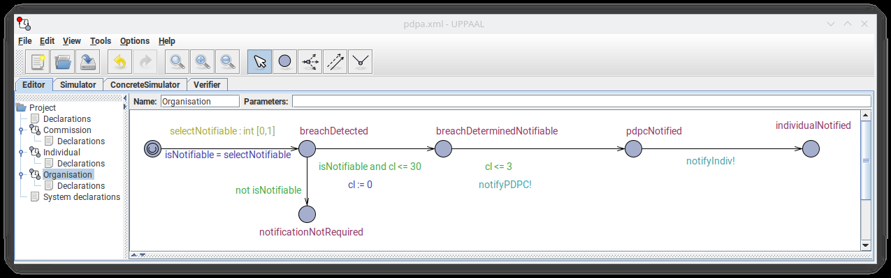
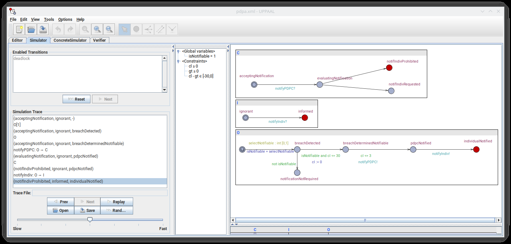

**STATUS 2026-09-23: DRAFT — rewritten for the intelligent lay reader at Meng's direction of 2026-09-23, with no length ceiling: every idea the argument leans on is now introduced in the post, with an example, where it is first needed. Not yet read by Meng. The facts are those of the fact-checked draft of 2026-09-15; what the rewrite added was checked on 2026-09-23 and is marked so in the Sources list — the Personal Data Protection Act's sections 26B to 26D and the 2021 Regulations, the Commission's breach-notification guide, section 3(1) of New Zealand's Rates Rebate Act and the pre-fix OpenFisca formula with its parameters, Waddington's example as the OECD paper prints it, the negation passage of the Imperial paper, and the Turing Award citation for model checking. Two illustrations, an insurance formula and a Robodebt claimant, are invented, and their notes say so.**

Beginning in 2015, hundreds of thousands of Australians opened letters from their government telling them that they had been overpaid welfare and owed the money back.
The amounts ran to thousands of dollars.
One man, who had lived with mental illness before, later told a Royal Commission that his notice, for eleven thousand dollars, left him in "complete shock," because it would "set me back years and years and years."
People took out loans, sold their cars and emptied their savings to pay debts they had been told to settle within weeks.
A woman described the day a debt collector took the money straight out of her bank account: "I felt desperate on that day; it was so upsetting that I could not afford to pay for my daughter's medical expenses and I felt powerless to improve my situation."
The Royal Commission, which reported in July 2023 in three volumes and 990 pages, found at least three suicides it could attribute to the scheme, and said it was "confident that these were not the only tragedies of the kind."
Two of the dead were young men, Rhys Cauzzo, 28, and Jarrad Madgwick, 22, whose mothers gave evidence on their behalf.[^1]

The debts were wrong.
They had been computed by a program that took each person's annual income, as reported to the tax office, spread it evenly across the year's twenty-six fortnights, and compared each fortnight's share with what the person had declared for that fortnight while on benefits.
Picture a woman who works for half a year and earns $26,000, then loses her job and spends the rest of the year on benefits with no income, which she correctly declares.
Averaged, her income looks like $1,000 a fortnight all year, including the thirteen fortnights in which she earned nothing, and the program concludes that she hid $13,000 while she was on benefits.[^2]
The social-security law asks what a person earned in each fortnight, and an annual average cannot tell you that.
The Royal Commission found that averaging used that way "was in fact inconsistent with social security legislation," and called the scheme, known everywhere as Robodebt, "a crude and cruel mechanism, neither fair nor legal."
The Federal Court, approving a class-action settlement in 2021, recorded debts totaling at least $1.763 billion unlawfully asserted against about 433,000 people, and about $751 million recovered from about 381,000 of them.

The defect had been found before the scheme began, by lawyers.
In November 2014 the social-services department was advised that income averaging "did not accord with legislation."
The Royal Commission found no evidence that the advice ever reached the department that ran the system.
The finding lived in a memo.
The code ran for four years.

Robodebt was a bug in a program that claimed to carry out a law.
The law itself was sound; the program misread it, and the people who could have said so had said so, on paper, somewhere the program never looked.
Laws can also carry bugs of their own, in the text itself, before anyone writes a line of code.
They are found, when they are found, the same way: by reading the rules with a machine's literal-mindedness and trying every case before the machine does it for real.
We found one of those in a Singapore statute, and it is a kind of bug that programmers, of all people, have a name for.

## A bug in the law itself

Suppose you are the person at a Singapore company who takes the call.
Someone has broken into your systems and copied your customers' personal data, and now it is your problem.
You know what the law expects, because knowing is your job.
Singapore's Personal Data Protection Act makes you work out, promptly, whether the breach is the kind the Act calls notifiable: one likely to do significant harm to the people whose data was taken, or one big enough to count as significant in scale, which the regulations put at five hundred people or more.[^3]
If it is, you must tell the regulator, the Personal Data Protection Commission (PDPC), as soon as practicable, and in any case within three days of deciding.
And if the breach is the harmful kind, you must also tell the people whose data was exposed, at the same moment you tell the Commission or after, so that they can change their passwords, call their bank, and watch for fraud.

So you start.
The Commission's form goes in first.
Your team drafts the email to customers.

Then the Commission comes back to you with a direction: do not tell the affected individuals.
The Act gives it that power in so many words.
An organization "must not notify any affected individual," it says, if "the Commission so directs."
Why the Commission would say such a thing, the Act does not explain.
I can guess — a state actor behind the breach, a disaster being managed somewhere upstream of you — but a guess is all it is, and nothing here turns on it.[^4]

Now the timing is everything.
If your email went out an hour before the direction arrived, you have done exactly what the Commission wanted prevented, and you did nothing wrong at the moment you did it.
If you held the email back to give the Commission room to object, you were sitting on a duty that is supposed to be done promptly.
You are holding the phone, and you have to choose which risk to run.

## Reading a law the way a computer does

In 2022 a government agency asked our group to turn that obligation into software, as one of the early pilots of a programming language for law we call L4.[^5]
We are a research group at Singapore Management University, and we have been building L4 for six years.
The idea behind it is simple to state.
A contract or a statute is already a set of instructions — if this, then that; unless this other thing; within thirty days — written for human readers, who are good at filling gaps and bad at noticing them.
L4 lets you write the same instructions a second time, clause for clause, in a notation strict enough for a computer to run, test and check, while staying close enough to the original that a lawyer can hold the two side by side and see that nothing was added or lost.
Writing a law out that way is called encoding it, and much of the work of encoding is discovering the questions the English never had to answer.

We encoded the breach-notification rules in an early version of the language, and from the encoding we generated a web wizard, which is still online.
A member of the public answers questions about their situation and gets back what they have to do, each answer citing the clause it came from.

A wizard answers the question in front of it.
It cannot tell you whether the rules, taken together, ever contradict themselves, because that depends on the order in which things happen: which message arrives first, how many days have passed, who knew what, and when.
The clauses of a law rarely fight each other inside a single sentence.
They fight, if they fight at all, on a particular afternoon.
And there are more possible afternoons than any person can read through.

Engineers who build systems with many parts running at once — the chips inside your phone, the protocols computers use to talk to one another, the software that runs inside cars and aircraft — have the same problem, and since 1981 they have had a class of tool for it, called a model checker.
You describe each participant as a simple machine: a handful of states it can be in, and the moves that take it from one state to the next.
You name a situation you never want to see — "the money has left one account and not arrived in the other."
Then the checker plays out every possible sequence of moves, systematically, until it has either visited every situation the machines can reach and can report that the bad one never occurs, or found a path to it, which it prints step by step.
That printout is called a trace, and it is the most useful thing a model checker gives you, because it turns "something might go wrong" into "here is exactly how."
The idea won its three inventors, Edmund Clarke, Allen Emerson and Joseph Sifakis, computing's highest honor, the Turing Award, for 2007.[^6]

The checker we used is called UPPAAL, built jointly at Uppsala University in Sweden and Aalborg University in Denmark, and its specialty is machines that keep time.[^7]
Each machine can carry clocks, and a move can be allowed only while a clock reads less than some number of days, which is exactly the shape of a legal deadline.
Machines like these are called timed automata.
L4 could not yet produce one on its own, so once we understood the fragment of the rules we cared about, we drew the model by hand: three machines, one each for the organization, the Commission and the affected individual, and one clock.

The organization's machine, as the paper that came out of the work printed it, is the one most people can read without help:

_Fig. 1(c): the Organization automaton in UPPAAL — one clock, 30 days to determine, 3 to notify. Mahajan, Strecker, Watt and Wong, WAICOM 2022, CC BY-NC-ND 4.0._

Read it from the left.
A breach is detected.
Within thirty days the organization decides whether it is notifiable, and at that moment its clock is set back to zero.
Within three days of that it notifies the Commission — the exclamation mark means "sends a message" — and after that it notifies the individual.
Or it decides no notification is required, and stops.
The three days come from the Act; the thirty come from the Commission's guidance on how long an assessment should take.[^8]
The Commission's machine is simpler still.
Once notified, it either requests that the individual be told or prohibits it, and since it decides on its own, for its own reasons, the model lets it go either way.

We asked UPPAAL one question: can these three machines ever reach a situation in which the individual has been told, and the Commission has prohibited telling them?

They can.
UPPAAL found a path and printed it.
The organization notifies the Commission.
The Commission prohibits notifying the individual.
The organization, which in this model cannot hear the Commission, notifies the individual.
The paper's explanation of why is worth quoting whole: the situation "comes about because the organization has no clue at which point the commission's interdiction to inform the individual could intervene, and is therefore entitled to inform the individual as soon as a data breach is identified."
Here is the last state of that run, as UPPAAL's simulator showed it, with the three machines beside it and their final states in red:

_Fig. 2: the failure trace in UPPAAL's simulator, last state (notifIndivProhibited, informed, individualNotified). Mahajan, Strecker, Watt and Wong, WAICOM 2022, CC BY-NC-ND 4.0._

The line to read is the bottom one of the trace: `(notifIndivProhibited, informed, individualNotified)`.
The Commission has prohibited; the individual is informed; the organization has notified.

A second question turned up a deadlock, a situation from which no move at all is possible.
If the organization has decided the breach is notifiable and then lets the three days run out, the model has nowhere left to go; in the paper's words, "no action is possible when the notification deadline of 3 days has been exceeded."

Put together, the two findings describe the bind the organization is in.
Tell your customers at once, and you may have done the very thing the Commission was about to forbid.
Tell the Commission and then hold off on your customers, to leave room for a direction, and you are slow on a duty that is supposed to be prompt.
The path that seems to satisfy both obligations satisfies them only by breaching the second one in the meantime.

Programmers have a name for this kind of defect.
They call it a race condition: a fault that appears only when events happen in an unlucky order.
The textbook example is a joint bank account with $100 in it and two cards.
Two people at two cash machines ask for $100 at the same instant.
Each machine checks the balance, each sees $100, each pays out, and the bank is $100 short, though neither machine did anything wrong by its own lights.
Nobody wrote a bad line.
The bug lives in the timing between good lines, which is why careful reviewers miss it and why it is found, when it is found, by tools that try every timing rather than by people who read every line.
The breach-notification rules have the same shape.
The organization's permission to notify its customers as soon as it has told the Commission, and the Commission's power to forbid that later, are each clearly written, and they race.

Philosophers were thinking about the logic of this before programmers were.
Deontic logic, from the Greek for "what is binding," is the study of reasoning with must, may and must not, and it has had its modern form since the Finnish philosopher Georg Henrik von Wright published a paper by that name in 1951.
Conflicts between duties have been among its standing puzzles ever since, along with the stranger question, which Roderick Chisholm made famous in 1963, of what you ought to do once you have already failed to do what you ought.[^9]
Our draft paper for the International Conference on Artificial Intelligence and Law calls what we found a contradictory conflict: one clause obliging an act that another forbids.
If "model checker" is new to you and you would like the longer story, James Somers's 2017 piece in _The Atlantic_ about Leslie Lamport and his specification language, TLA+, is the best way in that I know.[^10]

We wrote the work up that December with Avishkar Mahajan, Martin Strecker and Seng Joe Watt, for the International Workshop on AI Compliance Mechanism (WAICOM), and later worked the same case again in Maude, a different kind of tool that treats a system as a collection of rewriting rules.
It was one engagement, looked at from several sides.

## Is the bug in the law, or in our model?

A skeptical reader should be asking by now whether we found a flaw in the law or a flaw in our model of it.
It is the first question I would ask of anyone else's result.

Our model left things out on purpose.
Its organization could not hear the Commission, which is why, in the trace, it notified the individual after the prohibition; a real compliance officer reads their email.
Its deadline was a cliff, where the regulations tell a late notifier what to do: file anyway, and explain the delay.[^3]
A model is a caricature, drawn to make one feature visible, and what it leaves out can manufacture findings as easily as it can hide them.

The biggest thing a careless model leaves out is what lawyers call defeasibility: the way legal rules come with exceptions, exceptions to the exceptions, and rules about which rule wins.
A proviso carves a case out of a general duty.
A clause that opens "subject to section 12" gives way to section 12.
A regulation cannot override the Act it is made under.
An encoding that forgets any of this will report conflicts that are artifacts of the encoding rather than defects in the law, and a checker that cries wolf is worse than none, because people stop listening to it.[^11]

This Act, as it happens, says which rule wins.
The duty to tell individuals is written "subject to" the provision that lets the Commission forbid it, so on paper there is no contradiction: once the Commission directs silence, the duty to speak does not apply.[^3]
A model that carried that priority would go quiet about the prohibited-yet-informed state, because a real organization, hearing the direction, would stop.
But the priority settles what to do after the direction arrives, and the trouble is before it.
The Act lets the organization notify individuals as soon as it has notified the Commission.
It lets the Commission forbid that at any time.
It says nothing about how long to wait in between.
By the time a direction arrives, the organization may already have told the regulator, and some of its customers, that a breach was found, and whatever the silence was meant to protect is partly gone.
The rule that wins has won too late, and the thing the rules were for is still unmet.

What finally persuades me the corner is real is not our checker.
It is that someone reading the same rules without us saw the same corner and wrote a way out of it.
The Commission's own _Guide on Managing and Notifying Data Breaches_, revised in March 2021, reads the duty to tell individuals as one to be done "as soon as practicable, at the same time or after notifying the Commission."
Then, in the next breath, it advises that for breaches "likely to attract widespread public attention," or where an organization wants guidance about telling individuals, "organisations are strongly encouraged to notify and seek advice from the PDPC first before notifying the affected individuals."[^8]
That is the race, seen and handled: tell us first, and wait for our advice before you tell anyone else.
Whoever wrote the guidance had noticed.

Our method found the same corner from the rules alone, without the guidance.
A reader who has the rules without the guidance is still caught in it.
And a guide beside an Act does not amend the Act, which still says what it said.
We will come back to that at the end.

## A formula with two readings

The second finding was about money, and it is the one closest to anyone who has signed an insurance policy without reading it.

In 2023 a major insurer, one with millions of customers, asked us to formalize one of its policies.
It stays unnamed here.
To formalize a clause is to rewrite it precisely enough that a machine could compute from it, and for an insurance policy that means answering, for any claim at all, the question of exactly what gets paid.
The payout formula in this policy was not that precise.
It could be read two ways, and the two readings produced different amounts, so two customers with identical claims could be paid differently depending on who in the claims department read the sentence.

I cannot show you the clause.
But the kind of ambiguity will be familiar to anyone who has argued over brackets in a spreadsheet, and an invented example gives its flavor.
Suppose a policy promised to pay "80% of the loss less the deductible."
Is that 80% of whatever is left once the deductible comes off, or 80% of the loss, with the deductible then taken off the result?
On a $10,000 loss with a $1,000 deductible, the first reading pays $7,200 and the second pays $7,000.[^12]
Two hundred dollars on one claim is small.
Across every claim a formula touches, year after year, it is a line in a budget.

Our draft conference paper calls the gap in the real policy "material financial exposure"; my own estimate at the time, from memory, ran to millions of dollars in claims on the more generous reading.[^13]

Lawyers have a rule for this situation, old enough to have a Latin name: _contra proferentem_, "against the one who puts it forward."
When a contract term is ambiguous, it is read against the party that drafted it, on the theory that the drafter had every chance to be clear.
Singapore's Court of Appeal has said the rule "is particularly pertinent in insurance policies because these policies are invariably drafted and/or vetted by experts for the benefit of insurers so as to protect the latter's interest."
An ambiguity in an insurer's own formula is, by that rule, the insurer's problem.

We reported it.
The insurer reviewed its files and found that it had been making the larger payout.
That made the write-up delicate.
The claims adjusters who had helped us work through the policy were the very people who could be penalized for overpaying, so we presented the finding as a defect in the wording.
When it reached the executives, the conversation turned to liability.
Nobody said whether future claims would be paid on the stricter reading or the generous one.

As I recall it — the slides are lost, and the memory is not sharp — our presentation put two cases in front of them as examples of the risk an ambiguous term carries.
One was the Singapore case quoted above, _Tay Eng Chuan v Ace Insurance_.
The other was a 2023 judgment of the Court of Justice of the European Union, _Ocidental v LP_, about a term limiting cover in a group insurance policy that the insured person never had the chance to read.
Transparency, the Court said, means giving consumers what they need to understand a term's "economic consequences" before they sign.
Neither case is about a formula.
Both make one point.
Insurers have discretion — that is what adjusters are for — but a policy still has to stay out of a class of unpredictability that courts have refused to tolerate.
The fix went into the wording of the term, where the defect was, rather than into the software that computes the payout.[^14]

## The amount by which one number exceeds another

The third finding came earliest, it was the most informal, and it taught me the most about tests.

In New Zealand, as in Britain and Australia, local councils fund themselves partly through rates, a tax on property that homeowners pay every year.
Rates can be a heavy bill for a household with little income, so New Zealand offers a rates rebate under an Act of 1973: a discount on the bill that shrinks as the household's income rises.
By 2019 the rebate's rules had been written as code in OpenFisca, an open-source engine for tax and benefit rules that began in 2011 inside a French government policy unit and has since been taken up by governments from New Zealand to Canada.[^15]

The rules were written in Python, a widely used programming language, and like any serious software they came with tests.
A test, for a programmer, is a worked example with the answer filled in: for this income, these rates and this many dependants, the rebate should be exactly so much.
The computer reruns every test whenever the code changes and complains if any answer moves.
Tests are how programmers keep promises to themselves.
The rebate had thirteen of them, in two files.[^16]
Thirteen worked examples is a respectable number for a person to do by hand.
It is a very small sample of a formula that takes three inputs, each of which can be any of thousands of values.

In 2019 we pulled those rules into a very early prototype of L4.
Varun Patro, of the National University of Singapore, wrote a parser — a program that reads code written in one language and understands its structure — so that the formula could be carried across automatically rather than retyped.
The prototype was, as I remember it, "an early implementation just using S-expressions in raw Haskell, but that was enough to buy us QuickCheck."
S-expressions are the bracket-heavy notation of the Lisp family of languages.
Haskell is a language much used by people who think about correctness for a living, and QuickCheck is its best-known testing tool: instead of writing worked examples by hand, you state a rule the answers must always obey and let the machine invent hundreds of cases to try against it.
What the surviving record shows is humbler still.
We computed the rebate over a grid of cases, charted it, and looked.

Here is the formula, as the Python had it.[^17]
Take the rates bill and subtract $160, a share every household is expected to pay itself.
The rebate starts at two-thirds of what remains.
It is then reduced by $1 for every $8 by which the household's income exceeds an allowable income, which in 2019 was $25,180 a year for a household with no dependants.
Finally the result is capped: no rebate may be less than zero or more than $630.
The Act, as it reads today, puts the middle step as "$1 for each $8 by which the ratepayer's income for the preceding tax year exceeded" the threshold.

Everything turns on those words, "by which ... exceeded."
When income is below the threshold, it does not exceed it, and the amount by which it does so is zero.
The Python said something else.
It subtracted — income minus threshold, whatever the sign.

Take a household with $12,000 of income and a $1,000 rates bill.
The rebate should be two-thirds of $840, which is $560, with nothing taken off, because $12,000 does not exceed $25,180.
The Python computed the "excess" as minus $13,180, took an eighth of it, rounded down, and got minus $1,648.
Taking off a negative number adds it, so the rebate rose to $2,208, and the cap brought it back down to $630: seventy dollars more than the Act allows.
For a household with a $700 rates bill, the Act's $360 became the code's $630.
Every household below the income line was pushed upward in the same way, and the further below the line, the bigger the push, up to the cap.
Whether anyone was ever paid on the wrong answer is not on record.

We charted the rebate over a grid — combined income from $12,000 to $30,000 in $1,000 steps, rates from $100 upward in $100 steps, no dependants — and read the chart by eye.
At $1,000 of rates and $12,000 of income, the cell read $630.
With the excess read as the Act reads it, never less than zero, the chart came right.
Here are two rows and five columns of the corrected version, rates down the side and income across:

| rates \ income | $12,000 | $25,000 | $26,000 | $28,000 | $30,000 |
| -------------- | ------- | ------- | ------- | ------- | ------- |
| $100           | 0       | 0       | 0       | 0       | 0       |
| $1,000         | 560     | 560     | 458     | 208     | 0       |

The top row is zero throughout because a $100 bill is less than the $160 every household pays itself.
In the bottom row, the rebate holds at $560 until income passes $25,180, and by $30,000 the income deduction has eaten all of it.

We were not the only ones looking.
On 9 May 2019 — 10 May in New Zealand — one of the project's maintainers, Brenda Wallace, wrote the fix: one line, with the commit message "Clip excess to minimum zero (excess can't be negative)," and new tests a minute behind it.
It reached the public repository on 12 May.
Our chart dates from within a week of that, as near as the record fixes it; the shell prompts captured in our slide deck are stamped 14 May.
She found it by reading the code and reasoning about it, and we found it by charting an encoding.
Neither prompted the other.
The prototype is public, in the `smucclaw/complaw` repository at `doc/ex-nz-rates-20200909/aotearoa-haskell/`, not in this one.

## What three findings are worth

None of the three was a one-off contract.
Each was a rule that runs many times: a regulation every regulated business must follow, a formula applied to every claim, a calculator applied to every ratepayer.
That is where this kind of checking pays, because a defect in a rule that runs a million times is a million small defects.

Three findings are also three anecdotes, and it is worth being plain about what they do not show.
We have five engagements on the record.
The other two — a payments company whose fee tables we encoded and served to its other systems through a query interface, and a legislative drafting office that looked at the language with future drafting in mind — were not searches for defects.
So our record reads three searches, three findings, which sounds impressive and means very little.
Three out of three is a tiny sample, chosen by the people reporting it.

Formal methods, the family of mathematical techniques that model checking belongs to, have a long-standing version of this problem.
Jim Woodcock, Peter Gorm Larsen, Juan Bicarregui and John Fitzgerald, surveying sixty-two industrial projects in 2009, warned that people who saw no value in the methods would be "under-represented among the responses."
A formalization that finds nothing tends not to get written up either; that is our impression, and not something they measured.
The Imperial College group we are about to meet expected to find more ambiguity in the law they encoded than they did, and theirs is probably the common case.[^18]

## Somebody has been here before

None of this is new, and the people who got here first deserve their due.

In 1957 Layman Allen, later a law professor at the University of Michigan, published an article in the _Yale Law Journal_ whose title announced its tool: "Symbolic Logic: A Razor-Edged Tool for Drafting and Interpreting Legal Documents."
Its first sentence could stand at the head of this post: "A large amount of the litigation based on written instruments—whether statute, contract, will, conveyance or regulation—can be traced to the draftsman's failure to convey his meaning clearly."[^19]
Allen's remedy was to use the notation of logic as a drafting aid, forcing the _and_, the _or_, the _if_ and the _unless_ of a clause into the open where a reader could see how they nested.
Thirty-seven years later, with Charles Saxon, he narrowed the diagnosis.
Nearly all the ambiguity in legal writing, they argued, is ambiguity in the small words that express logical structure, and "virtually all of the imprecision resulting is inadvertent."[^20]
Nobody means to write an ambiguous _or_.
English simply lets them.

In the summer of 1983 a group at Imperial College London — Marek Sergot, Fariba Sadri, Robert Kowalski and three colleagues — set out to put a large part of the British Nationality Act 1981 into a computer.
They used Prolog, a programming language in which you write down facts and rules and then ask questions, and the machine works out the answers by chaining the rules together: a person is a British citizen if they were born in the United Kingdom after the Act came into force, and a parent of theirs was a citizen or settled here at the time, and so on down.
In January 1984 they showed the program to Home Office officials who had been involved in drafting the Act, and in May 1986 they published it in _Communications of the ACM_, the flagship magazine of computing's main professional society.[^21]

They had expected the law to be full of vagueness and ambiguity.
It was not.
They "found fewer such examples than we originally expected," and where ambiguity did exist, "it was usually possible to identify the intended interpretation with little difficulty."
What they found instead was a bug of their own making, and it is the best illustration I know of the way writing a rule down precisely forces choices the English never had to make.

Section 1(2) of the Act deals with abandoned babies.
A newborn infant found abandoned in the United Kingdom shall, "unless the contrary is shown," be deemed to have been born here to a parent who was a British citizen or settled here — and so is a citizen.
The phrase does humane work.
Nobody knows who a foundling's parents are, so the law presumes the answer that protects the child and puts the burden on anyone who wants to argue otherwise.

Prolog has a peculiar idea of _not_.
In Prolog, "not X" means "X cannot be proved from what I know."
That is a sensible reading most of the time, and the Imperial group used it throughout: if you cannot show that someone falls under an exception, treat them as not falling under it.
But "unless the contrary is shown" hides two negations.
The contrary is that the child was _not_ born to a qualifying parent, and the presumption holds _unless_ that is shown.
Read both negations the Prolog way, and follow a foundling whose parents are unknown.
"Born to a qualifying parent" cannot be proved, because nobody knows anything about the parents.
So "not born to a qualifying parent" counts as established, by default.
So the contrary has been shown, the presumption falls away, and the program declines to make the baby a citizen.
The authors' verdict: "exactly the opposite of what is intended by the act."
Their fix was to read the inner _not_ as ordinary negation, something that has to be positively established rather than merely left unproven.
No tool reported that bug.
The act of formalizing forced a choice, and the obvious choice went the wrong way.

Their conclusion was Allen's.
A logical representation, they wrote, could be used "not only to apply the rules, but to aid the process of drafting and redrafting the rules in the first place," and "can also help to derive logical consequences of the rules and therefore test them before they are put into force."

They had a critic almost at once.
Philip Leith, in _The Computer Journal_ the same year, accused the team of "a muddled view of the legal process."[^22]
The objection, in the form it has taken ever since, is that law is more than its text: there is the guidance, the practice, the tribunal, the discretion.
It is a fair objection, and the breach-notification rules are an instance of it, since the corner we found in the text is handled in practice by a guide that sits beside it.
Where we part company with the critics is on what follows from that.
A checker that shows the people who write a text where it contradicts itself, guidance and all, makes no claim that the text is the whole of the law.

The idea went into government anyway, under the name rules as code.
In 2018 a New Zealand team spent three weeks together — business-rules specialists, legislative drafters, policy people, service designers and software developers — trying to write two Acts as code: the Holidays Act, and the Rates Rebate Act from the section above.
Its members had a memorable phrase for what the usual process makes of lawyers once a law is enacted: modems, the go-betweens that translate one system's signals into another's.
The Organisation for Economic Co-operation and Development (OECD), the Paris-based body of mostly wealthy countries, wrote the movement up in 2020, and defined rules as code as "a machine-consumable version of some types of government rules, to exist alongside the existing natural language counterpart."
In 2021 Catala, a language for law from France's national computer-science research institute, Inria, and from Microsoft Research, was tried on French family benefits, and its authors reported that in doing so they had uncovered "a bug in the official implementation."[^23]
There is newer work, in the United States, the Netherlands, Norway and Australia among other places, and the notes list some of it.[^24]

The movement has serious critics, and their objection deserves stating in their own words.
"What code-driven law does," writes the legal philosopher Mireille Hildebrandt, "is to fold enactment, interpretation and application into one stroke, collapsing the distance between legislator, executive and court."
That distance is what lets a court tell a government it has misread its own law.
A 2021 report for the New Zealand Law Foundation came down on a similar line, and the Foundation announced it under the headline "Legislation should not be code, but law as code is the future."[^25]
The objection is to code that replaces the legal text, or stands in for it unannounced.
A checker that shows a drafter where the text contradicts itself, before it is enacted, is a different thing, and it is the thing on offer here.

Every name so far belongs to a logician or a computer scientist.
Howard Darmstadter is a transactional lawyer — three decades of deal documents, and a drafting course at the Benjamin N. Cardozo School of Law in New York — and in November 2010 he published an article called "Precision's Counterfeit" in _The Business Lawyer_, the American Bar Association's business-law quarterly.[^26]

He had set his class a revolving credit agreement to simplify.
A revolving credit agreement, or revolver, is a standing loan facility, something like a corporate credit card: a company may borrow up to a limit, repay, and borrow again.
When the limit is large, several banks share it — a syndicate — each committing to fund its own slice of every draw.
This one came from one of New York City's leading firms, and Darmstadter had reviewed it as the borrower's lawyer "on a nearly annual basis over some fifteen years."
He believed it bulletproof.
"I thought merely to skim off some of the surface algae," he wrote.
"But when I did, and looked into the now crystalline waters of the pond, I saw . . . sharks."

The first shark was a pair of clauses.
The opening section made each bank's duty to lend conditional on the loans staying in proportion to the banks' commitments.
Suppose three banks.
A has committed $50 million, and B and C $25 million each, so A should always hold half of whatever has been lent.
Now C fails to fund its share of a draw.
If A and B fund theirs, A holds two-thirds of the loans instead of half, the proportion is broken, and A and B can argue that the condition on their own duty has failed and they are released as well.
The very next section says that one bank's failure to lend "shall not in itself relieve any other Lender of its obligation to lend."
Nothing in the agreement says which clause governs.
Here were two provisions that cannot both be honored, in a situation the agreement itself allows to arise, in a form that had "no doubt been pored over by many of the firm's lawyers and by lenders' and borrowers' counsel in numerous transactions."
No tool found it.
He did, by rewriting a sentence for a class.

Darmstadter is careful about what follows.
In practice, he says, the ambiguity will "generally not cause any problems," because "Borrowers and lenders are generally honest people," and experienced hands know which clause was meant.
The exposure comes on the day a deal goes bad and a judge reads the clauses, and the judge, he notes, "is unlikely to be an experienced hand."

## Three kinds of bug

Step back from the cases and they sort into three kinds, and the sorting says something about which tools find which.

The first kind is one clause with two readings.
The insurer's formula is one.
So is a small classic that Waddington, a senior legislative drafter in Jersey, wrote up in 2019 and the OECD reprinted.
It concerns work in New South Wales on encoding a grant for parents of children "aged four and a half to eighteen."
A human knows what four and a half means.
A computer has to be told the exact moment, and the moment is not obvious.
Half a year is 182.5 days, so a child born at seven in the morning has lived exactly half a year at seven in the evening 182 days later.
If eligibility were measured to the minute, the OECD's commentary adds, a program could turn away families that any reasonable person would say qualified.[^23]
Nobody drafting "four and a half" imagined a stopwatch.
A computer has nothing else.

The second kind is code that disagrees with its text.
The New Zealand rebate is one: the Act said one thing, the Python another, and the Python was what ran.
Catala's bug in the French benefits calculation is another.
The worst I know of is Robodebt, where this post began: a sound law, a program that averaged a year where the law asked about each fortnight, and a lawyer's finding that never traveled from the memo to the machine.
Code that has drifted from the law it claims to apply is the failure rules-as-code programs talk about most, and Robodebt shows what it costs when the check is made and the result goes nowhere.

The third kind is two rules that cannot both be obeyed, in a situation the rules themselves allow you to reach.
The breach-notification race is one, and Darmstadter's revolver is another.
Each clause is clear on its own, and each would be carried out faithfully by a careful person.
The defect is in how they meet, and it shows itself only in particular circumstances: a default by one bank of three, a direction that arrives after the email has gone.
This is the kind that reading is worst at finding, because a reader goes clause by clause and the bug lives between clauses.
It is also the kind that machines are best at, because a machine can list the situations the rules allow and look for one in which an obligation and a prohibition land on the same act.
That search has a research literature going back to 1992, and it has been automated before: for contracts in 2009, and for business processes in 2013.[^27]
What the breach-notification pilot adds is the clock.
The duties ran against deadlines, so the conflict arrived as a matter of timing — a sequence of permitted steps with a late piece of advice in it — rather than as a clash between two rules standing still.

## The tooling gap

Programmers have an enormous kit for exactly these problems.
A compiler reads their code before it runs and refuses to proceed if the pieces do not fit together.
Version control keeps every draft and records who changed what, and why.
Test suites rerun hundreds of worked examples every time anything changes.
Model checkers try every timing.
In a software team, "we found a race condition" is a normal Tuesday.

Graphic designers have Adobe: Illustrator, InDesign, Photoshop, a tool for every corner of the trade.
Lawyers have Microsoft Word.
In fairness, they have a little more than that.
HotDocs has assembled documents from templates since 1993; Oracle Policy Automation turns rules into eligibility interviews for government agencies; docassemble has done the same for free since 2015, and L4 can compile to it.[^28]
None of them tells you the instrument contradicts itself.

The gap is odd, because the work is not that different.
A corporate lawyer and a programmer both take what somebody wants and turn it into a text that has to anticipate the behavior of a complicated system, with many moving parts and, often, an adversary looking for the gap.[^29]

Darmstadter puts it more bluntly than a technologist could get away with.
Complex legal documents, he says, are already written in what he calls "the programming style": exhaustive detail, and no explanation of what any section is for.
They have the two properties programs have, too.
They are "extraordinarily brittle," breaking when an assumption the drafter made turns out to be false, and they "tend to contain lots of mistakes (in computerese, 'bugs')."
His remedies read like an inventory of what programmers already own: comments, for which his example is the remark statement an early programming language, BASIC, let a programmer leave for a later reader; worked examples; proper notation for the formulas that prose garbles; diagrams; and a spreadsheet you can push ranges of numbers through, which he calls "not a foolproof method, but it turns up mistakes surprisingly often."
He stops short of handing the calculation to a computer, on the ground that programmers make mistakes too, and he is right about that.[^26]
But the kit he asks for is the kit programmers use.

I came to this from the technology side, and one afternoon made the debt plain to me.
It was a Thursday in my 2016–17 fellowship year at Harvard's Berkman Klein Center for Internet & Society, and I was presenting my plans for L4.
Scott Bradner was in the room.
Bradner wrote Request for Comments (RFC) 2119, the 1997 document that tells every engineer who writes an Internet standard how to use the words MUST, MUST NOT, SHOULD and MAY: in capitals, and with fixed meanings, so that two companies building to the same standard build the same thing.[^30]
I had co-written RFC 4408, the Sender Policy Framework, in 2006, one of the standards that lets a mail server check whether a message really comes from where it claims to, so we had both written rules for machines to follow, and we got talking about those capitalized words.
Technologists borrowed them from law decades ago and built the Internet with them.
Now it is time to return the debt, with interest.
Berkman was where I thought about the social side of that: what it means to move the rule of law onto a rules-as-code platform, and who is allowed to give legal advice once a machine can.
CodeX, Stanford's Center for Legal Informatics, where I spent another fellowship year, was where I thought about the programming-language side: what a specification language for law should look like, and how close to English it can stay.

The legal-technology market is not short of companies.
When I checked in September, Stanford CodeX's TechIndex listed 5,761 of them, 389 in contract management and 898 in document management and automation.[^31]
None of its categories is for checking whether an instrument is consistent.
The newest entrants use large language models, the technology behind ChatGPT, to review contracts, and they will flag a clause as possibly inconsistent with another.
That is useful, and it is a different kind of answer.
A language model reads the way a careful person reads, which makes its flag a well-informed guess that someone has to check, and its silence no guarantee of anything.
A model checker enumerates.
When it says nothing was found, it has looked at every situation its model allows, and when it finds something, it hands you the steps.

Here is what L4 does today, and what it does not.
A command called `l4 verify` reads each decision rule in an encoding as its logical skeleton — its ands, ors and nots, with the underlying facts treated as opaque — and reports rules that can never be satisfied, branches that can never be reached, and conditions that make no difference to the outcome.
It does not look at numbers or dates.
Its findings are sound only for the encoding it is given, and its silence is not a proof that the rules are consistent.
A second command, `l4 state-graph`, draws the obligations in an encoding as a diagram of states and moves, the same kind of machine as the UPPAAL figure above.
Asking the breach-notification question of that diagram automatically means translating the L4 into the input of a timed model checker such as UPPAAL.
That translation is designed and not built, and its specification lists reproducing this very race condition as a test it has yet to pass.[^32]

If you run a small company and signed a lease this year without reading it, there is nothing here for you yet.
This kind of checking earns its cost on rules that run many times — regulations, policies, benefit formulas, standard-form contracts — where one defect is repeated in every case the rule touches.
The academic version of the argument is a draft for the International Conference on Artificial Intelligence and Law (ICAIL), which states the double bind the way a computer scientist would, as a reachability question: can the system reach a state in which one clause obliges what another forbids?
A later post in this series climbs a ladder of such techniques, from the serial comma up to model checking.[^33]

## The guidance, and the offer

Come back to the person holding the phone.

What our method found from the rules alone, the Commission's guidance had already found, and in practice it handles the case.
Tell us first, it says, in effect, and wait for our advice before you tell your customers.
An organization with good lawyers will have read it.
But a reader who has only the Act is caught.
And a guide is not the Act.
It is not what Parliament passed, and the Commission has revised it before and can revise it again without asking Parliament.
Found at drafting time, the same corner could have been closed in the text itself, with a sentence giving the Commission a stated number of days to respond before individuals are told, for instance, rather than in a note beside it.
The offer is to the drafters as much as to the readers, and one legislative drafting office has already looked at L4 with that in mind.[^34]

The Home Office officials who watched the Imperial group's program in January 1984 said something the authors recognized: that this could help with drafting the rules in the first place, a point Layman Allen had made in 1957.
Forty-two years later, that is still the offer.
Find the corner before anyone is holding the phone, and write the way out into the law, rather than into the note beside it.

## Sources

### Notes

[^1]: Federal Court of Australia (FCA), summary accompanying _Prygodicz v Commonwealth of Australia (No 2)_ [2021] FCA 634 (Murphy J): the Commonwealth "unlawfully asserted such debts, totalling at least $1.763 billion against approximately 433,000 Australians," "recovered approximately $751 million from about 381,000 of them," and under the settlement "will pay $112 million inclusive of legal costs"; conduct the Commonwealth "belatedly admitted was unlawful." The summary says the only authoritative statement is the published reasons. Read in the copy hosted by the applicants' solicitors, <https://gordonlegal.com.au/app/uploads/2023/08/prygodicz-v-commonwealth-of-australia-no-2-2021-fca-634-summary.pdf> (checked 2026-09-13); the court's own site and AustLII refused the request today. Australian Broadcasting Corporation (ABC) News, "Robodebt royal commission findings revealed," 7 July 2023, <https://www.abc.net.au/news/2023-07-07/robodebt-royal-commission-findings-revealed/102531450> (three volumes, 990 pages, 57 recommendations; scheme ran 2015 to 2019; its "$1.8 billion settlement" is the headline package, not the class-action payment). Law Society Journal, "Crude, cruel and unlawful: Robodebt Royal Commission findings," read via the Wayback Machine at <https://web.archive.org/web/2024/https://lsj.com.au/articles/crude-cruel-and-unlawful-robodebt-royal-commission-findings/> because the live page returned 503 today: quoting the report, "Robodebt was a crude and cruel mechanism, neither fair nor legal" and "The use of income averaging, in the way it was proposed, was in fact inconsistent with social security legislation"; on the November 2014 advice that income averaging "did not accord with legislation" and the absence of evidence it was communicated to the delivery department. The Commission's own site timed out today. The suicides, and the particulars in the post's opening: BBC News, Frances Mao, "Robodebt: Illegal Australian welfare hunt drove people to despair," 7 July 2023, <https://www.bbc.com/news/world-australia-66130105> (fetched by curl 2026-09-14): "The inquiry found there were at least three known suicides as a result of Robodebt policy, and it was 'confident that these were not the only tragedies of the kind'"; it names two of the men, Rhys Cauzzo, 28, and Jarrad Madgwick, 22, whose mothers testified. Re-read 2026-09-23 (HTTP 200 to a browser-like request) for the opening's other particulars, all as the BBC reports them: people "received letters saying they owed thousands of dollars in debt"; many were forced into "taking out loans, selling their cars or using savings to pay off a debt they were told they had to pay within weeks"; a man "who had experienced mental illness previously" said that on receiving "a $A11,000" debt notice he was in "complete shock" because it would "set me back years and years and years"; a woman whose "lowest point" was "the day the debt collector debited the money from her bank account," quoted in full in the body; and the two men, "whose mothers gave testimony to the commission last year on their behalf." The BBC also puts the number affected at "more than half a million"; the body uses the court's count. If this subject touches you, in Australia Lifeline answers on 13 11 14. The BBC gives the scheme's start as 2016; the body keeps ABC's 2015, the year the averaging began under its earlier name. The Commission is cited for its narrative findings, the 2014 advice and the deaths; the court's summary for the money and the unlawfulness.

[^2]: The woman and her figures are invented to show the mechanism; she is not a case from the record. The mechanism — annual tax-office income spread evenly across twenty-six fortnights and set against what the person declared fortnight by fortnight — is as the sources in note 1 describe income averaging, and the Royal Commission's finding that averaging used that way was "inconsistent with social security legislation" is quoted from the same note.

[^3]: Personal Data Protection Act 2012 (Singapore), ss 26B, 26C and 26D, and the Personal Data Protection (Notification of Data Breaches) Regulations 2021 (S 64/2021), both read on 2026-09-23 in their current versions through lawplain, a mirror of Singapore Statutes Online (`sso.agc.gov.sg/Act/PDPA2012`, `sso.agc.gov.sg/SL/PDPA2012-S64-2021`). Each of the three sections carries the amending-act tag [40/2020] and no later one; the Regulations came into operation on 1 February 2021, and s 26C(1) applies the assessment duty to breaches on or after that date, so the text quoted is the text in force during the 2022 pilot. Section 26B(1): a breach is notifiable if it "results in, or is likely to result in, significant harm to an affected individual" or "is, or is likely to be, of a significant scale"; reg 4: "the prescribed number of affected individuals is 500." Section 26C(2): the organization "must conduct, in a reasonable and expeditious manner, an assessment of whether the data breach is a notifiable data breach" — the body's "promptly." Section 26D(1): it "must notify the Commission as soon as is practicable, but in any case no later than 3 calendar days after the day the organisation makes that assessment"; reg 5(4) requires the form and manner the Commission specifies. Section 26D(2): "Subject to subsections (5), (6) and (7), on or after notifying the Commission under subsection (1), the organisation must also notify each affected individual affected by a notifiable data breach mentioned in section 26B(1)(a) in any manner that is reasonable in the circumstances" — so the duty to individuals attaches to the significant-harm limb only, and the Act states no deadline for it; "as soon as practicable" for individuals is the Commission's guide (note 8). Section 26D(6): "An organisation must not notify any affected individual in accordance with subsection (2) if — (a) a prescribed law enforcement agency so instructs; or (b) the Commission so directs." The body mentions only limb (b). Regulation 5(2): a notification made after the three days "must additionally specify the reasons for the late notification and include any supporting evidence" — the body's "file anyway, and explain the delay." None of the Act, the Regulations or the guide says how long an organization should wait between notifying the Commission and notifying individuals; the body's "It says nothing about how long to wait in between" is about the Act and the Regulations, and the guide's advice is quoted for what it does say.

[^4]: The instrument is Singapore's Personal Data Protection Act, its data-breach notification obligation — "PDPA DBNO" in the project's repositories — and the year is 2022, both given by Meng on 2026-09-14 and recorded in `blog/README.md`, "Framing constraints — Post 1", "The year, and the paper." The pilot's understanding of the obligation, as Meng described it on 2026-09-14, in the same README section: "in the event of a data breach which has been assessed as being a notifiable data breach, the organization must notify, as soon as possible, both the affected parties (users whose data was exposed) and the government regulator. The government regulator may some time later advise the organization to not advise the affected parties … That places the organization in a double bind: you must notify, and you must not notify." His speculation about the regulator's reasons ("presumably because major breaches call for disaster management in some way, or maybe the breach was tied to a state sponsored actor") is marked as speculation there and is reported as a guess in the body. The tool, in his words: "This analysis was done with an early version of our language and the UPPAAL encoding was performed manually once the fragment of the regulation was understood." The record is consistent with the year and does not fix it on its own, and the body gives 2022 as the year of the pilot proper: the repository activity runs wider than 2022 on both sides. In `smucclaw/dsl`, `caseStudies/PDPA/README.org` was created 2021-07-19 ("the future home of the L4 rules regarding the PDPA, at first just the notification obligation"), and the `pdpadbno-*` encodings and their parser tests carry commits from 2021-12-21 to 2023-06-18, those dated 2022 running from 6 January to 20 December. In `smucclaw/vue-pure-pdpa`, the web wizard at <https://smucclaw.github.io/mengwong/pdpa/>, the first commit is dated 2021-09-12 and 187 commits carry a 2022 commit date (160 excluding merges); by author date the figures are 185 and 158, and the 185 in `blog/README.md` is that author-date count. All read from `git log` in local checkouts of both repositories on 2026-09-14; commit counts move with the pathspec and with the date field, which is why the encodings are dated rather than counted. The wizard answered HTTP 200 on 2026-09-14. The case-study README lists, among the circumstances in which an organization need not notify an individual, that the regulator instructed it not to — whether or not the organization had asked — and that a law-enforcement agency did; the body describes the bind in those terms. One discrepancy to flag: `paper/icail/l4-icail.tex` §Experience calls the pilot's instrument "a piece of secondary legislation"; the Act is a statute, and which of the Act and any rules made under it the pilot's fragment was drawn from is not on record — the body quotes the Act and its 2021 Regulations as they read today (note 3) and does not say which the pilot's fragment was drawn from. Which agency commissioned the pilot stays unnamed. What may be disclosed about the engagement: the ICAIL paper's header still lists "confirm what may be disclosed about each pilot" as an open editorial item.

[^5]: The pilot accounts here are Meng Wong's, from the project's working record and, where the body says so, from memory; the pilots are described in deliberately general terms in the draft ICAIL paper, `paper/icail/l4-icail.tex`, §Experience and Open Questions ("With a government agency we encoded a piece of secondary legislation for regulatory compliance and generated a web wizard that lets members of the public enter their circumstances and see their obligations, each answer carrying citations to the source rules"). The agency and the insurer stay unnamed; the first pilot's instrument, its year and its public paper are in notes 7 and 4. "Six years" is Meng's figure, recorded in `blog/STYLE.md` §6 on 2026-09-13. "An early version of L4" is his phrase of 2026-09-14 (note 4).

[^6]: The ACM A.M. Turing Award for 2007 went to Edmund M. Clarke, E. Allen Emerson and Joseph Sifakis. The citation, as reproduced at the head of the laureates' joint paper "Model Checking: Algorithmic Verification and Debugging," _Communications of the ACM_ 52(11), November 2009, DOI 10.1145/1592761.1592781, read 2026-09-23 in the copy at <https://www-verimag.imag.fr/~sifakis/TuringAwardPaper-Apr14.pdf>: "In 1981, Edmund M. Clarke and E. Allen Emerson, working in the USA, and Joseph Sifakis working independently in France, authored seminal papers that founded what has become the highly successful field of Model Checking"; the method determines whether a model "satisfies a formal specification expressed as a temporal logic formula," and "if the property does not hold, the method identifies a counterexample execution that shows the source of the problem" — the body's trace. Its examples of use are "VLSI circuits, communication protocols, software device drivers, real-time embedded systems, and security algorithms," which the body's list paraphrases. The ACM's own award pages refused a scripted request that day.

[^7]: The paper: Avishkar Mahajan, Martin Strecker, Seng Joe Watt and Meng Weng Wong, "Compliance through model checking," International Workshop on AI Compliance Mechanism (WAICOM 2022), December 2022, SMU InK, <https://ink.library.smu.edu.sg/cclaw/3/> — record and abstract read 2026-09-14, and the paper read in full 2026-09-14 from the PDF Meng supplied (8 pages; the InK record's PDF is the accepted version). Its abstract: "we describe part of a case study about Singapore's Personal Data Protection Act, which we first presented informally, then formally as interacting Timed Automata." §2 (p. 3) gives the informal account: three actors — the organization, the Personal Data Protection Commission ("henceforth only called the commission") and the individual, "the multitude of affected individuals" abstracted to one "as there is no interaction among the individuals"; up to thirty days to assess whether a breach is notifiable; the commission and the individual to be informed within three days of that; and "the organization must not notify an affected individual if the commission so directs." §3.1 Formal Model (pp. 4–5) and Fig. 1 (p. 4): three interacting timed automata, (a) Commission, (b) Individual, (c) Organization; "there is one clock, `cl`," reset on the transition from `breachDetected` to `breachDeterminedNotifiable`; the Organization's guards are `isNotifiable and cl <= 30` then `cl <= 3` with `notifyPDPC!`, then `notifyIndiv!`; "we have here made the choice to sequentialize the notifications (the commission, then the individual)," since UPPAAL has no nested parallel automata; the Commission's choice after `notifyPDPC?` is non-deterministic, "modeling the fact that the commission's decision to prohibit or request the notification of the affected individual is autonomous and not influenced by external factors"; and the model is deliberately incomplete, so a run "can get stuck in an intermediate state." §3.2 Checking the Model (pp. 5–6) and Fig. 2 (p. 5): the queries are in CTL, the temporal logic the paper states them in ("requirements that are typically stated in a formal logic, here the temporal logic CTL"); `E<> I.informed and C.notifIndivRequested`, the good case, holds; `E<> I.informed and C.notifIndivProhibited` — "the individual is informed in spite of the commission having prohibited it" — "is also satisfied, and Uppaal produces a trace (Figure 2) leading to this error situation," the sentence on why quoted in the body; and `E<> O.breachDeterminedNotifiable and deadlock` holds: "in this state, no action is possible when the notification deadline of 3 days has been exceeded." §4.1 adds that "a precise interaction between the commission and the organization is not made explicit in the law text." The body's "which in the model cannot hear the Commission," and note 11's "takes no message from the Commission," are read off Fig. 1(c), whose Organization automaton has two send actions and no receive. Both figures are embedded as the paper's own images, extracted unaltered with `pdfimages` on 2026-09-14; provenance, licence and the two figures not shown in the body, Fig. 1(a) and 1(b), are in `blog/assets/waicom-2022/README.md`. The licence in the captions, CC BY-NC-ND 4.0, is as the InK record states it, read in a browser on 2026-09-14 and recorded there; the PDF's own cover sheet confirms the record URL ("Available at: https://ink.library.smu.edu.sg/cclaw/3") and carries no licence string, and the record refused a non-browser request again on 2026-09-14, so that one browser reading is the only check behind the licence. The paper's §2 refers to sections of the Act by number; the sections the body quotes are in note 3, from today's text. `paper/formal-methods-in-law/FORMAL-PAPER.md` §1 records the same case in its list of case studies as "race condition (timed automata / UPPAAL)." That file's §4.4 and §3 table list the "PDPA data-breach notification race condition (our UPPAAL study)" and "the government-agency race condition from our regulatory pilot" as two exhibits, the first described as "interacting clocks (assessment window vs notify-the-regulator window)." Meng, 2026-09-14, recorded in `blog/README.md`: "there was one engagement but we worked it several ways: Uppaal and then Maude. The double bind was both deontic and temporal: if the org notified the government then waited a while to notify the users they would potentially be able to comply with a non-notification notice that arrived in the interim. The only way to comply with a non-notification notice from the regulator is to violate the immediate notification requirement to the affected users. And vice versa." So the two exhibits are one engagement, and the body's statement of the bind is drawn from his, without his opening absolute: read against the Act's text (note 3), obeying a direction does not breach the duty to individuals, which is made subject to it, so the body states the bind as the timing risk the rest of his account describes; the paper's own framing is the prohibited-yet-informed trace plus the deadlock past the 3-day deadline, and the body gives both. The Maude line, in which Watt, Goodenough and Wong later gave L4 an executable semantics: Seng Joe Watt, Oliver Goodenough and Meng Weng Wong, "Deontics and Time in Contracts: An Executable Semantics for the L4 DSL," _Legal Knowledge and Information Systems_ (JURIX 2023), Frontiers in Artificial Intelligence and Applications, IOS Press, 7 December 2023, DOI 10.3233/faia230954 — Crossref record confirmed 2026-09-14, not read; that it is the Maude line of the same work is `blog/README.md`'s gloss of Meng's "Uppaal and then Maude," and it is cited here for the executable semantics only, not as a PDPA result. The finding as the ICAIL draft states it: `paper/icail/l4-icail.tex`, §The Regulative Layer, "Why this matters": "In one of our public-sector deployments, exactly such a deontic-temporal double bind was discovered automatically in live regulation: under an unusual interleaving, a party was simultaneously obliged and prohibited from the same act." "Automatically" there is the model checker's search, not the construction of the model, which was by hand. Also recorded in `specs/proposals/VERIFICATION-BACKEND-LOWERING-SPEC.md` (case study 1) and in `doc/concepts/legal-modeling/residual.md`. The description of what UPPAAL is — a model checker for networks of timed automata, from Uppsala University and Aalborg University — is the tool's own, from <https://uppaal.org/>, read 2026-09-14: "an integrated tool environment for modeling, validation and verification of real-time systems modeled as networks of timed automata," "developed in collaboration between the Department of Information Technology at Uppsala University, Sweden and the Department of Computer Science at Aalborg University in Denmark"; the paper itself says only "the Uppaal [9] model checker," its reference 9 being Larsen, Pettersson and Yi, "Uppaal in a nutshell," STTT 1(1), 1997; the pilot's model is as Fig. 1 prints it. The model carries no exception or priority — the Organization automaton has no transition on a prohibition — and the paper says its model is incomplete; the body rests the finding's reality on the guidance for that reason. Status of the shipped tooling: `paper/formal-methods-in-law/FORMAL-PAPER.md` §4.4 ("the model-checking backend is designed, not built") and the spec's own header ("Phase 1 is ruled but not built … no prover exists in the tree as of" 2026-09-07).

[^8]: Personal Data Protection Commission, _Guide on Managing and Notifying Data Breaches under the Personal Data Protection Act_, "Revised on 15 March 2021," <https://www.pdpc.gov.sg/-/media/files/pdpc/pdf-files/other-guides/guide-on-managing-and-notifying-data-breaches-under-the-pdpa-15-mar-2021.pdf>, read in full text on 2026-09-23 (page numbers are the PDF's, which match the guide's printed folios). P. 19: "Section 26D(2) of the PDPA prescribes that organisations must notify affected individuals as soon as practicable, at the same time or after notifying the Commission. However, for data breaches which are likely to attract widespread public attention and/or interest, or those which organisations require guidance on notifying the affected individuals, organisations are strongly encouraged to notify and seek advice from the PDPC first before notifying the affected individuals." P. 22: an organization "is required to take reasonable and expeditious steps to assess whether the data breach is notifiable under the PDPA within 30 calendar days" — the model's thirty days. P. 25, "Timeframes for notification": the Commission "no later than three (3) calendar days," and affected individuals "as soon as practicable, at the same time or after notifying the Commission." Note that the guide's paraphrase of s 26D(2) adds "as soon as practicable," which the section's own words do not contain (note 3); the body attributes that phrase to the guide. Meng's account (note 34) is that the race condition was documented in the guidance accompanying the rules. This guide says so in terms, and is quoted as that guidance; which guidance document the pilot team had in front of them in 2022 is not on record. The guide was revised on the date above, which is the body's "has revised it before."

[^9]: Georg Henrik von Wright, "Deontic Logic," _Mind_ 60(237):1–15 (1951), DOI 10.1093/mind/LX.237.1; Roderick M. Chisholm, "Contrary-to-Duty Imperatives and Deontic Logic," _Analysis_ 24(2):33–36 (1963), DOI 10.1093/analys/24.2.33. Both are in `paper/icail/l4-icail.bib`; the bibliographic records were confirmed against Crossref on 2026-09-13, and neither paper was re-read today. "Contradictory conflict" is the ICAIL draft's phrase (§The Regulative Layer), not a term the field owns, and not the WAICOM paper's, which never uses the word: its §1 speaks of "problems of the current legislation that could be termed an internal inconsistency"; the nearer standard term is normative conflict, as in Sartor's title in note 27.

[^10]: James Somers, "The Coming Software Apocalypse," _The Atlantic_, 26 September 2017, <https://www.theatlantic.com/technology/archive/2017/09/saving-the-world-from-code/540393/> (checked 2026-09-13; the page's own metadata dates it 2017-09-26). Cited as an on-ramp, not as evidence for any claim here.

[^11]: `specs/proposals/VERIFICATION-BACKEND-LOWERING-SPEC.md`, "The Crux: Defeasibility": "a naive deontic encoding will report 'conflicts' that are artifacts of the encoding, not bugs in the law"; "The regulatory race condition above is real precisely _because_ it survives that discharge." That second sentence is our own assertion, not a method, which is why the body rests the point on the guidance instead. The examples of defeasibility in the body (a proviso, a "subject to" clause, a subordinate instrument yielding to its parent act) are general and not cited to any jurisdiction; none of them states a canon that a later clause overrides an earlier one within a single instrument. The priority the body gives is the Act's own: s 26D(2) is "Subject to subsections (5), (6) and (7)" (note 3). Meng reached the same result by another route on 2026-09-14 (`blog/README.md`): "Even if we read this with 'lex posterior' framing so that the organization stops notifying users the moment they hear from the regulator, as a whole the system has already leaked the fact that the breach was detected so somewhere some high level goal is going unmet." His "already leaked" is the body's "whatever the silence was meant to protect is partly gone." The pilot's model did not carry the priority — its Organization automaton, Fig. 1(c) of the WAICOM paper (note 7), takes no message from the Commission.

[^12]: The eighty-percent policy is invented for this post and has nothing to do with the insurer's clause, which is not on record (note 13). Its arithmetic: 80% of ($10,000 − $1,000) is $7,200; 80% of $10,000, less $1,000, is $7,000.

[^13]: Meng's account: "an ambiguity in the payout formula that potentially meant that the insurer was leaking (that's the technical term) potentially millions of dollars in claims." `l4-icail.tex` §Experience puts it as "an ambiguity in a payout formula with material financial exposure"; the body uses the paper's phrase and attributes the larger figure to our own estimate. The body does not use "leaking": a reviewer objected that the industry's term "claims leakage" names losses in claims handling rather than in policy wording, and nothing turns on the word. Nothing more specific about the clause is on record. The rule of construction: _Tay Eng Chuan v Ace Insurance Ltd_ [2008] SGCA 26, Singapore Court of Appeal, CA 95/2007, decided 27 June 2008, read on eLitigation, <https://www.elitigation.sg/gd/s/2008_SGCA_26>, 2026-09-14: "The _contra proferentem_ rule is particularly pertinent in insurance policies because these policies are invariably drafted and/or vetted by experts for the benefit of insurers so as to protect the latter's interest," and "any ambiguity in the extent of insurance coverage provided by the Policy should be construed against the respondent" insurer. Cited for the rule, which is general; the case has nothing to do with our insurer.

[^14]: What followed is Meng's account of 2026-09-14, recorded in `blog/README.md`, "Framing constraints — Post 1", in two parts; the second corrects the first as to who raised the cases. First: "The insurer reviewed what it had been doing — it had been making the larger payout, not the smaller — and we had to finesse the explanation of the case to management because we were acutely aware that the team of insurance adjusters who had been kindly assisting us with the pilot project could potentially be penalized for overpaying. When we presented the findings at CxO level though the top management simply observed that the newly discovered ambiguity of the contract may have exposed them to a 'Ocidental – Companhia Portuguesa de Seguros de Vida v LP, C-263/22, CJEU, 20 April 2023' liability risk, and that clarifying the ambiguity would save them that liability; no mention was made of whether they would lean stricter or stay generous in future payouts. So the fix was at the right layer: at the abstract logic and not necessarily the particular algorithm." Later the same morning: "Let's put in both Ocidental and Tay Eng Chuan; IIRC it was our presentation to management at the insurer that highlighted these cases as risks, but the presentation is lost to time and I have only a vague memory that it was this class of suit that we mentioned as representative of 'yes, insurers have some discretion — that's what adjusters do — but policies need to avoid certain classes of unpredictability, and courts have agreed.'" The first account's "management simply observed … a liability risk" is withdrawn as to attribution; the body follows the second, hedged as he hedges it. The year: in the project's working repository the substantive insurance work runs from March to November 2023, including presentation material dated 25–26 July 2023; three later commits on the same paths, in February and July 2024, change a server URL and restructure a Haskell file, maintenance rather than pilot work (read 2026-09-14 and recorded in `blog/README.md`; whether that is the presentation Meng remembers as lost is for him to say). _Ocidental_ was decided 20 April 2023, before any of it, so the presentation could have cited it; had the pilot predated the judgment, the case could only have been the later authority for the same class. The case: _Ocidental – Companhia Portuguesa de Seguros de Vida SA v LP_, C-263/22, Judgment of the Court of Justice of the European Union (CJEU), Ninth Chamber, 20 April 2023, on a reference from Portugal's Supremo Tribunal de Justiça; EUR-Lex CELEX 62022CJ0263, with a summary at 62022CJ0263*SUM. Its headnote: Directive 93/13/EEC on unfair terms in consumer contracts, Articles 3 to 6; criteria for assessing the unfairness of a contractual term; the requirement of transparency; a group insurance contract; permanent invalidity of the consumer; the duty to provide information; non-disclosure of a term limiting or excluding cover against the insured risk. The judgment was read on 2026-09-14: first from EUR-Lex's HTML view of CELEX 62022CJ0263 in a browser session (EUR-Lex and CURIA serve a bot-check page to scripts), then in full from the EUR-Lex PDF saved from that browser, 57 numbered paragraphs plus the operative part, against whose extracted text every quotation below was matched verbatim. Paragraph 29: the transparency requirement "entails the obligation to provide the consumer, prior to the conclusion of the contract, with all the information necessary to enable the consumer to understand the economic consequences of those terms and to decide, in full knowledge of the facts, to be contractually bound," and so "necessarily presupposes that the consumer is able to become acquainted with all the terms of a contract before the conclusion thereof." Paragraph 26: transparency "must be construed broadly" and "cannot be reduced merely to those terms being formally and grammatically intelligible." Paragraph 41: a lack of transparency because the consumer could not become acquainted with the term at all "may, a fortiori," be an element in the unfairness assessment. Operative part: (1) Articles 4(2) and 5 of Directive 93/13, read with its 20th recital, mean "a consumer must always be afforded the opportunity, before the conclusion of a contract, to become acquainted with all the terms"; (2) where such an exclusion-or-limitation term is found unfair, the national court "is required to exclude the application of that term." The body's "economic consequences" is paragraph 29's phrase. A published note, Vadim Mantrov, "Consumer Being a Party to the Group Insurance Contract is Not Just a Silent Observer: The CJEU's Clarification in Ocidental," \_European Journal of Risk Regulation* (2024), read on Cambridge Core 2026-09-14, was the secondary source before the judgment was opened. It is a transparency-and-disclosure case about a limiting term, not a case about an ambiguous formula, which is why the body says neither case is about a formula and describes each as what it holds. "The fix was at the right layer" is Meng's; the body says where the fix went and no more.

[^15]: OpenFisca, "About", <https://openfisca.org/en/about/> (checked 2026-09-13): development began in May 2011 at the French government's strategic-analysis unit, since April 2013 called France Stratégie; in 2018 the product manager who had led its international work moved to New Zealand, "where the recently established Service Innovation Lab was finishing writing its Better Rules report"; the Rates Rebate app was "the first service in production outside of Europe"; later adoption in Australia, Polynesia and Canada. The scheme, the parser and the grid are from Meng Wong's deck "Multi-Way Isomorphism in L4: a humble universal converter for rules as code" (Google Slides, document id `1U4pQFXuVAocbwzF1nPtyhxH2SBza_7nEErLPE2lnAAw`; text export read 2026-09-14). The export carries no date for the deck itself; its two shell prompts are stamped `20190514`, which puts it no earlier than 14 May 2019, and "2019" in the body is inferred from that. The deck works through OpenFisca-Aotearoa's `rates_rebates` formula, credits the Python parser to Varun Patro of the National University of Singapore (NUS), names the prototype's S-expression operators (`SoMuchOf`, `Inxs` — which the surrounding slides use as the excess operator; the phrase "in excess of" does not occur in the export — and `IntDiv`), shows the evaluator printing an explanation in the Act's words ("560.00 — which is the lesser of …"), and carries those two prompts dated 2019-05-14. The deck's repository path, `legalese/complaw-deeptech`, `ontologies/rules/aotearoa-haskell`, returns 404 today. The prototype now lives in `smucclaw/complaw` (last pushed 2024-07-10), at `doc/ex-nz-rates-20200909/aotearoa-haskell/` — `app/Main.hs`, `l4/from-openfisca-rr.l4`, and beside them `l4/rr-br3nda-clip.l4` and `l4/rr-br3nda-noclip.l4` — confirmed against the GitHub tree API (`repos/smucclaw/complaw/git/trees/HEAD?recursive=1`, not truncated) on 2026-09-14; the three `.l4` files were read through the GitHub contents API the same day (see note 16), `app/Main.hs` was not opened. The body's step-by-step description of the rebate is the OpenFisca formula's, and its quotation of the Act is from today's text of s 3(1); both are in note 17.

[^16]: Meng's account of 2026-09-14, recorded in `blog/README.md`, "Framing constraints — Post 1": "We did the work in a very early prototype of the L4 system; an early implementation just using S-expressions in raw Haskell but that was enough to buy us QuickCheck." QuickCheck, the Haskell property-testing library, is his recollection of what the prototype made possible; the word does not occur in the deck's export, whose evidence is the grid — a chart of the rebate over combined income $12,000–$30,000 in $1,000 steps against rates of $100 to $2,000 in $100 steps, dependants 0, with the deck's own captions "this looks wrong," "That's better" and "This now reflects 'legislative intent'" — so the body reproduces a slice of the grid (two of its twenty rows, five of its nineteen columns, cells verbatim; the deck's tables print a hyphen where the body prints a minus sign) and attributes QuickCheck to him. His earlier account, in the project's working record: a "bug that the New Zealand government was facing with mis-calculating entitlement benefits"; the tools "only had a handful of tests"; "We wrote a Python parser and imported the whole thing into a Haskell environment, and then brought on some big guns – HSpec – to generate and run automated tests across the entire domain of possible scenarios." "Entire domain" is retired here: the domain was a grid, and the oracle was a person reading the chart. "A handful of tests" was measured on 2026-09-14 at the fix's parent commit, `faf5a1686e36`: `openfisca_aotearoa/tests/rates_rebates/rates_rebates_2018.yaml` holds nine test cases and `rates_rebates_2019.yaml` four, thirteen for the rebate; the repository as a whole carried thirty-six test YAML files. The bug, as the deck diagnoses it, is the semantics of "excess": "the amount by which a exceeds b" coded as `a − b` where the Act means `max(0, a − b)`. Where it bites: `allowable_income` is $25,180 with no dependants, so `combined_income − allowable_income` is negative only below that threshold; there the unclipped "excess" was subtracted from the rebate, which raised it, and the Python's final `clip(rebate, 0, maximum_allowable)` then held it at the $630 maximum. Above the threshold the excess is positive and the clip changes nothing. The deck's slide order separates two defects: its first S-expression, which has no outer clip, charts negative rebates past the threshold; its second wraps the outer subtraction in `Inxs`, and the chart — zeros in place of negatives — is still captioned "this looks wrong"; its third wraps `Inxs` around `combined_income − (income_threshold + …)` inside `excess_income`, the analogue of `.clip(min=0)`, and that chart is "That's better" and "This now reflects 'legislative intent'". The visible effect of the third change is below the threshold (rates $100, income $12,000: 100 to 0; rates $700 to $2,000: 630 to 360–630), which is why the body locates the defect in the left-hand block rather than in the negative cells, and says the negatives were our encoding's.The prototype's two `rr-br3nda-*.l4` encodings, read through the GitHub contents API the same day, take `SoMuchOf (Descr "rates_total") …` before the minimum against `maximum_allowable`, which caps the rebate at the rates paid and turns 1,608 into 100; `from-openfisca-rr.l4`, the direct translation, mirrors the Python and has no such cap. None of the three reproduces the deck's first table exactly, so the deck's slide sequence is not re-derived here; its corrected table is — every cell of it follows from the parameters at that commit. Correct in both is $0. The upstream fix: OpenFisca-Aotearoa commit `68d839ebbd73`, <https://github.com/BetterRules/openfisca-aotearoa/commit/68d839ebbd73bb5fedb1f274eb3c710c229c12dc>, "Clip excess to minimum zero (excess can't be negative)", author Brenda Wallace (GitHub `Br3nda`), one file (`openfisca_aotearoa/variables/acts/rates_rebates/rates_rebates.py`), one line: `excess_income = floor((… combined_income … - allowable_income) / 8)` gains `.clip(min=0)` at the end. Authored 2019-05-09T22:34:57Z, the morning of 10 May in New Zealand; committed 2019-05-12T18:59:57Z, the morning of 13 May in New Zealand. The tests commit, `3e637466a669`, "Tests for 2019, rates rebate: rebate, min and max," is its child, authored a minute later (2019-05-09T22:36:02Z) and carrying the identical committer date, so the two reached the repository in one push; the body's "a minute behind" is the author-date gap (all four dates re-read from the GitHub commits API on 2026-09-14). The commit page and the repository's commit list for 8–15 May 2019 were opened on 2026-09-14. The repository was then `ServiceInnovationLab/openfisca-aotearoa`; the old name redirects (HTTP 301, checked 2026-09-14) to what is now `BetterRules/openfisca-aotearoa`. The deck credits the fix by handle to `@Br3nda` and `@Verbman`. Against the deck's shell prompts of 14 May 2019, the fix is five days earlier by its author date and two days earlier by the date it reached the upstream repository; the body gives both dates and puts the fix before our chart, and says "within a week" rather than "the same week" because 9 and 14 May 2019 fall in different calendar weeks and the prompt date is only the nearest date the record gives, not the day of the chart. Who saw it first: Meng, 2026-09-14, recorded in `blog/README.md` — "the chart was not what prompted Br3nda's fix; they found it and we found it simultaneously; they found it by inspection and reasoning; we found it by lightweight formal methods." That is his recollection; nothing in the deck or the commit history says either side knew of the other, and the body claims only what he does. `paper/formal-methods-in-law/FORMAL-PAPER.md` §6 says the exercise "surfaced a miscalculation that affected real people's entitlements"; the body claims less, since whether any claimant was ever paid on the unclipped formula is not on record. The exercise predates the current L4 implementation; nothing in the present tree is that parser (the tree's OpenFisca code, `jl4-core/src/L4/OpenFisca/Emit.hs`, compiles L4 _to_ OpenFisca).

[^17]: The formula as the Python computed it, read 2026-09-23 from OpenFisca-Aotearoa at the fix's parent commit `faf5a1686e36` through the GitHub contents API: `openfisca_aotearoa/variables/acts/rates_rebates/rates_rebates.py` computes `rates_minus_contribution - ((rates_minus_contribution / 3) + excess_income)`, returned through `clip(rebate, 0, maximum_allowable)`, with `excess_income = floor((combined_income - allowable_income) / 8)` and `allowable_income` the income threshold plus $500 per dependant. The parameter files at the same commit give `initial_contribution` 160 (from July 1990), `income_threshold` 25,180 (from July 2018), `additional_per_dependant` 500 (from July 2006) and `maximum_allowable` 630 (from July 2018). The body's worked cases, recomputed from those: rates $1,000 and income $12,000, no dependants — $840 × 2/3 = $560; floor(−13,180 / 8) = floor(−1,647.5) = −1,648; $560 + $1,648 = $2,208, clipped to $630; with the excess floored at zero, $560. Rates $700 — $360 against $630. The corrected table in the body is note 16's, and every cell follows from the same parameters. The Act: Rates Rebate Act 1973 (New Zealand), s 3(1), read 2026-09-23 at <https://www.legislation.govt.nz/act/public/1973/0005/latest/DLM409673.html> (the site answered a browser-like request; it refuses bare scripts), in its current form: a rebate of "(a) so much of the rates payable for that rating year in respect of the property as represents— (i) two-thirds of the amount by which those rates exceed $160, reduced by— (ii) $1 for each $8 by which the ratepayer's income for the preceding tax year exceeded the ratepayer's income abatement threshold, the amount of that threshold being increased by $500 in respect of each person who was a dependant … or (b) $830,— whichever amount is smaller." The $830 is today's cap; the 2019 figures are the parameters above. The 2019 wording of s 3(1) was not read, which is why the body quotes the Act "as it reads today." The Act's opening words, "so much of the rates payable," also keep a rebate from exceeding the bill, a limit the Python did not state and that its excess bug could breach; the body does not pursue it.

[^18]: The five engagements: the four in `l4-icail.tex` §Experience (government agency, insurer, drafting office, payments fintech) plus the New Zealand exercise of note 16. Jim Woodcock, Peter Gorm Larsen, Juan Bicarregui and John Fitzgerald, "Formal Methods: Practice and Experience," _ACM Computing Surveys_ 41(4), article 19 (October 2009), DOI 10.1145/1592434.1592436. The survey covered "62 industrial projects," data collected "between November 2007 and December 2008" and published in 2009; on bias: "This may have biased it towards those with whom we have the strongest contacts," and "due to the bias in selection described above, one would expect stakeholders that did not see value in the use of formal methods to be under-represented among the responses." Read in the authors' draft as hosted at <https://homepage.cs.uiowa.edu/~tinelli/classes/181/Fall14/Papers/Wood09.pdf> (checked 2026-09-13); the ACM copy returned 403 today, so page numbers in the published version are not given. "Probably the common case" is our impression, not theirs, and so is the sentence before it about formalizations that find nothing going unwritten; their survey measured response bias, not publication bias.

[^19]: Layman E. Allen, "Symbolic Logic: A Razor-Edged Tool for Drafting and Interpreting Legal Documents," _Yale Law Journal_ 66(6):833–879 (1957). Opening sentence as given on the University of Michigan Law School repository page, <https://repository.law.umich.edu/articles/1694/> (checked 2026-09-13).

[^20]: Layman E. Allen and Charles S. Saxon, "Controlling Inadvertent Ambiguity in the Logical Structure of Legal Drafting by means of the Prescribed Definitions of the A-Hohfeld Structural Language," _Theoria_ 9(21):135–172 (1994); abstract: "Virtually all of the ambiguity imprecision encountered in legal discourse is ambiguity in the language used to express logical structure, and virtually all of the imprecision resulting is inadvertent." <https://repository.law.umich.edu/facarticles/636/> (checked 2026-09-13).

[^21]: M. J. Sergot, F. Sadri, R. A. Kowalski, F. Kriwaczek, P. Hammond and H. T. Cory, "The British Nationality Act as a Logic Program," _Communications of the ACM_ 29(5):370–386 (May 1986). PDF read at <https://www.doc.ic.ac.uk/~rak/papers/British%20Nationality%20Act.pdf> (checked 2026-09-13). "Summer 1983", the January 1984 Home Office demonstration and the Allen 1957 attribution: pp. 370–371. The expectation sentence, p. 371, in full: "In addition to vagueness, legislation is generally thought to contain both imprecision and ambiguity … In fact, we found fewer such examples than we originally expected." Section 1(2), the two negations and "exactly the opposite of what is intended by the act": p. 380 — the rule's last two conditions each read _not [x was not …]_; the authors take the first _not_ in each as negation as failure and argue that the second "should be interpreted as ordinary, classical negation." "Test them before they are put into force": p. 371. The paper's last sentence, p. 385, runs the other way and is worth having: "the accumulated experience of managing complex systems of law may teach us something about the maintenance of large bodies of complex software." Re-read 2026-09-23 from the same PDF: the drafting sentence the body quotes, "not only to apply the rules, but to aid the process of drafting and redrafting the rules in the first place — a point that was made by Layman Allen [1] as long ago as 1957," and the next sentence, "A similar observation was brought to our attention when we first demonstrated our implementation in January 1984 to officials from the Home Office who were involved in drafting the act" (p. 371); and the negation passage (p. 380), where, for an infant whose parents are both unknown, the condition "x has a parent who qualifies under 1.1 on date y" fails, so the inner negative condition succeeds and the outer one fails: "We fail to conclude that the abandoned infant acquires citizenship by Section 1-(2)." The body's step-by-step account follows that paragraph. The six authors are named in the citation above; the body names the first three.

[^22]: Philip Leith, "Fundamental Errors in Legal Logic Programming," _The Computer Journal_ 29(6):545–552 (1986), DOI 10.1093/comjnl/29.6.545. Only the abstract was readable today (Oxford Academic; the Queen's University Belfast repository page carries no PDF), so the body paraphrases the abstract's own summary of the argument — that the Imperial team "have a muddled view of the legal process and of the usefulness of logic programming in that field," and that Leith wished "to dispute the power of logical programming" — and quotes nothing from the body of the paper. Checked 2026-09-13.

[^23]: James Mohun and Alex Roberts, _Cracking the Code: Rulemaking for Humans and Machines_, OECD Working Papers on Public Governance No. 42 (OECD Publishing, 2020). PDF read at <https://www.oecd.org/content/dam/oecd/en/publications/reports/2020/10/dechiffrer-le-code_d56cab77/3afe6ba5-en.pdf> (checked 2026-09-13). The OECD is the Paris-based intergovernmental body of mostly rich countries. Its definition of Rules as Code, p. 6 (Executive Summary): "a machine-consumable version of some types of government rules, to exist alongside the existing natural language counterpart." Better Rules: Box 2.4, pp. 22–23, quoting the New Zealand discovery report (Digital.Govt.NZ, 2018) — the discovery ran "over three weeks in 2018," the team "contained business rules specialists, business analysts, legislative drafters, service designers, policy specialists and software developers," the two acts were the Rates Rebate Act and the Holidays Act, and the finding was that "it is difficult to produce machine-consumable rules if the policy and legislation has not been developed with this outcome in mind." "Lawyers as modems": p. 32, where it is attributed to Andrews in the OECD Observatory of Public Sector Innovation (OPSI) 2019 trends report, p. 106. The OECD's sentence on limits, p. 33: the point of rules as code "is not necessarily to eliminate this challenge or ambiguity, but instead to make it visible to both implementers and policy makers." The four-and-a-half-years example: Box 3.2, p. 33, quoting M. Waddington, Senior Legislative Drafter in the Government of Jersey, "Machine-consumable legislation: A legislative drafter's perspective," _The Loophole_ 2019(2). The New Zealand discovery report itself sits behind a bot wall today and was not opened; its words here are as the OECD quotes them. Catala: Denis Merigoux, Nicolas Chataing and Jonathan Protzenko, "Catala: A Programming Language for the Law," _Proceedings of the ACM on Programming Languages_ 5 (ICFP), 2021; arXiv:2103.03198 v2, 2 July 2021 (checked 2026-09-13). Affiliations from the byline: Merigoux, Inria; Chataing, Inria and the École Normale Supérieure (ENS), Paris; Protzenko, Microsoft Research. The quotation is the abstract's; the full sentence reads "in doing so, we uncover a bug in the official implementation of the French benefits." Inria's later page on Catala's work with the French tax administration was behind a bot wall today and is not relied on. Re-read 2026-09-23 from the same PDF. Box 3.2's quotation of Waddington begins "An example is work done in New South Wales on encoding a provision that said a grant was payable to parents of children aged four and a half to eighteen," and continues "Half of a year is 182.5 days (unless a leap year). So half of a year, measured from the child's actual hour, minute and second of birth, would expire at a point 12 hours later in the relevant day (a child born at 07:00 on a given day, will have lived for exactly half a year at 19:00 on whatever is the day that is 182 days later)." The OECD's commentary below the box: "If age were to be measured to the minute, for example, this may exclude individuals who should have reasonably qualified for the grant." The body's gloss on "modems" is the OECD's own, from its list of problems with the current process: the process "positions certain individuals (especially, lawyers and others whose roles require them to interpret the specifics of the rules) as 'modems', that is, the necessary interlocutors and intermediaries for interpreting the rules and translating them into other forms."

[^24]: Current work, named here and not in the body. The Georgetown experiment: Ariel Kennan, Alessandra Garcia Guevara and Jason Goodman, _AI-Powered Rules as Code: Experiments with Public Benefits Policy_, Beeck Center for Social Impact + Innovation and Massive Data Institute, Georgetown University, published 24 March 2025, <https://beeckcenter.georgetown.edu/report/ai-powered-rules-as-code-experiments-with-public-benefits-policy/> (checked 2026-09-13): the experiments ran June–September 2024 on Supplemental Nutrition Assistance Program (SNAP) and Medicaid eligibility rules, the analysis finished between October 2024 and February 2025, and the finding as the report page states it is that "LLMs are capable of supporting the process of generating code from policy, but still require external knowledge and human oversight within an iterative process for any policies containing complex logic." Only the report's web page was read, not the PDF. Elsewhere: Open Overheid, "Opleiding Wetsanalyse en wendbare wetsuitvoering," 26 February 2024, <https://www.open-overheid.nl/actueel/nieuws/2024/2/26/opleiding-wetsanalyse-en-wendbare-wetsuitvoering>: a course in the structured reading of legislation for implementation, _wetsanalyse_, run by the Open Universiteit with Universiteit Leiden for IT staff, lawyers, managers and other professionals involved in preparing or implementing legislation; its third edition began in May 2024. Labo Société Numérique, "OpenFisca: when a digital commons turns law into code," 12 December 2023, <https://labo.societenumerique.gouv.fr/en/articles/openfisca-quand-un-commun-numerique-transforme-la-loi-en-code/> ("From 2023 to 2025, the Netherlands and Greece will be experimenting with OpenFisca modeling"). Digdir, "Spesifikke anbefalinger for å lage automatiseringsvennlig regelverk," last updated 22 August 2025, <https://www.digdir.no/datadeling/spesifikke-anbefalinger-lage-automatiseringsvennlig-regelverk/2879>: "Regelverk som kode, eller Rules as Code (RaC), er en metode hvor regelverket skrives som maskinlesbar kode samtidig som det skrives i vanlig tekst." 2026 OpenFisca Conference, Canberra, 30–31 March 2026, University of Canberra, <https://openfisca.org/en/conference/2026/> — the program page was read; no proceedings or report of the event was consulted. All checked 2026-09-13.

[^25]: The critics. Mireille Hildebrandt, "Code-driven Law: Freezing the Future and Scaling the Past," in Christopher Markou and Simon Deakin (eds), _Is Law Computable? Critical Perspectives on Law and Artificial Intelligence_ (Hart, 2020), pp. 67–83, DOI 10.5040/9781509937097.ch-003; at p. 70: "What code-driven law does is to fold enactment, interpretation and application into one stroke, collapsing the distance between legislator, executive and court"; her definition at p. 67 ("legal norms or policies that have been articulated in computer code"). Read in the publisher's PDF, linked from the Vrije Universiteit Brussel (VUB) research portal, <https://researchportal.vub.be/en/publications/code-driven-law-freezing-the-future-and-scaling-the-past/>, and hosted at <https://www.cohubicol.com/assets/uploads/hildebrandt-freezing-the-future-and-scaling-the-past.pdf> (checked 2026-09-13). Tom Barraclough, Hamish Fraser and Curtis Barnes, _Legislation as Code for New Zealand: Opportunities, Risks, and Recommendations_ (Brainbox Institute, for the New Zealand Law Foundation, March 2021), [2021] NZLFRRp 3. The report itself is behind a bot wall at the New Zealand Legal Information Institute (NZLII) today and was not opened; the Law Foundation's release announcing it, "'Legislation should not be code, but law as code is the future': New research released," <https://lawfoundation.org.nz/?p=11610> (checked 2026-09-13), summarizes the finding in its own voice: "Enacting legislation in code undermines the separation of powers and the role of the Judiciary. It also confers too much power on Executive government." Those two sentences are the release's, not a quotation of the authors, and the report's own wording was not seen.

[^26]: Howard Darmstadter, "Precision's Counterfeit: The Failures of Complex Documents, and Some Suggested Remedies," _The Business Lawyer_, vol. 66, November 2010, pp. 61–83 — read in full 2026-09-15 from the PDF in Meng's papers library (23 pages; text extracted with `pdftotext -layout`), and every phrase quoted here matched against that extraction, each occurring in it exactly once. Page numbers are from the article's own running heads. That _The Business Lawyer_ is the American Bar Association Business Law Section's quarterly is the Section's own statement of it, <https://www.americanbar.org/groups/business_law/resources/business-lawyer/submission-guidelines/>, read 2026-09-15; the article's running head gives only "The Business Lawyer; Vol. 66, November 2010." The author line (p. 61): "Currently consults on documentation issues and teaches drafting as an adjunct professor at the Benjamin N. Cardozo School of Law"; his own book is _Hereof, Thereof, and Everywhereof: A Contrarian Guide to Legal Drafting_ (2d ed. 2008), cited at p. 73 n.22. The abstract states the thesis the title compresses: "Contracts and other transaction documents are frequently said to be complex and difficult to read in order to avoid ambiguity and mistakes. I argue that such complexity has not solved these problems, and may have exacerbated them." His verdict on the securitization documents he had spent years with, p. 61: "almost comically incomprehensible, frequently ambiguous, and occasionally produced the wrong numbers" — a result he says surprised him, since "Like most lawyers, I had originally assumed that there was a trade-off between simplicity and accuracy" (p. 62). The revolver runs pp. 62–65: the algae-and-sharks sentence and the assignment to his class at p. 62; clause (ii), which he names the proportionality condition, quoted at p. 63; the three-lender example (A committed at $50 million, B and C at $25 million each), the arithmetic of C's default (A's share rising from 50 percent to 66.67 percent), the following section's "shall not in itself relieve" proviso, and "there is no express statement in the agreement as to which provision is to control" all at p. 64. His own caveat, kept in the body's "can argue": the ambiguity will "generally not cause any problems," because "Borrowers and lenders are generally honest people" and "Experienced hands will know that it is the first statement of the proportionality condition that is at fault"; the exposure is the judge, who "is unlikely to be an experienced hand" (p. 65). He offers it as diagnosis rather than survey — "Two examples from one agreement do not constitute a survey" (p. 70) — and did not pick the document to demonstrate flaws but because he thought it bulletproof. "The Programming Style" is his section heading at p. 71, where the brittleness and bugs sentences also sit; "hopelessly backward" and his name for current practice, eyeball testing, at p. 72; the remark statement, which he illustrates from the BASIC programming language ('Programs written in BASIC, for example, contain "REM" (for "remark") statements'), under "Explanations," at p. 73; the spreadsheet proposal and the quoted sentence about plugging in ranges of numbers at pp. 78–79; his maxim "Never say anything more than once at the same level" at p. 80; and the Methodological Postscript at pp. 82–83. Two limits on what he is cited for. He is not writing about rules as code, does not mention it, and stops his remedies at explanations, notation, diagrams and spreadsheets — he rejects handing the calculation over outright: "So can we just yield all power to the computer? No" (p. 80), his reason being that programmers make mistakes too, and his recommendation being a document at multiple levels of description, reconciled "through a process of triangulation." And his brittleness charge cuts at an L4 encoding exactly as it cuts at a revolver: his own example of a false drafting assumption is that eurocurrency reserves would never bear interest, which the Fed's 2008 change falsified (pp. 69, 71), and his point is that nothing in a programming-style document lets a reader tell a bug from a feature. He is cited here for the diagnosis, not the prescription.

[^27]: The body's "1992," "contracts in 2009" and "business processes in 2013" are, in order: Giovanni Sartor's paper on normative conflicts; Fenech, Pace and Schneider's contract analyzer (CLAN), which found obligation–prohibition conflicts in formal contracts; and Guido Governatori's Regorous, which checked business processes for compliance. Giovanni Sartor, "Normative conflicts in legal reasoning," _Artificial Intelligence and Law_ 1(2–3):209–235 (1992), DOI 10.1007/BF00114921. Gordon J. Pace, Cristian Prisacariu and Gerardo Schneider, "Model Checking Contracts — A Case Study," Automated Technology for Verification and Analysis (ATVA) 2007, Lecture Notes in Computer Science 4762:82–97, DOI 10.1007/978-3-540-75596-8*8. Fenech, Pace and Schneider, "Automatic Conflict Detection on Contracts," Theoretical Aspects of Computing (ICTAC) 2009, Lecture Notes in Computer Science, pp. 200–214, DOI 10.1007/978-3-642-03466-4_13, and "CLAN: A Tool for Contract Analysis and Conflict Discovery," ATVA 2009, pp. 90–96, DOI 10.1007/978-3-642-04761-9_8. Governatori and Shek, "Regorous: a business process compliance checker," Proceedings of the Fourteenth International Conference on Artificial Intelligence and Law (ICAIL 2013), pp. 245–246, DOI 10.1145/2514601.2514638. Sharifi, Parvizimosaed, Amyot, Logrippo and Mylopoulos, "Symboleo: Towards a Specification Language for Legal Contracts," 28th International Requirements Engineering Conference (2020), pp. 364–369, DOI 10.1109/RE48521.2020.00049. Harry Surden, "Computable Contracts," \_UC Davis Law Review* 46:629 (2012), first page read at <https://lawreview.law.ucdavis.edu/sites/g/files/dgvnsk15026/files/media/documents/46-2_Surden.pdf>. Every other record in this note was confirmed against Crossref on 2026-09-13 and not read in full today; they are named as prior work, and the body claims of each no more than its title says. Pace, Prisacariu and Schneider 2007, Symboleo and Surden are named in this note and not in the body.

[^28]: Oracle Policy Automation (OPA), now Oracle Intelligent Advisor: Wikipedia, "Oracle Intelligent Advisor" (the article formerly titled "Oracle Policy Automation," which now redirects to it), read 2026-09-13 — "Oracle Corporation acquired OPA in December 2008 when it purchased the Australian software company RuleBurst Holdings, then trading as Haley"; the users named there include the UK's tax authority (an employment-status tool, dated 2006 there, under the product's pre-Oracle owner) and Australia's immigration department (visa eligibility, sourced there to a June 2009 press report), which is why the body says "for agencies" and leaves the named agencies here. HotDocs: Wikipedia, "HotDocs," read 2026-09-13 — "Version 1.0 of HotDocs was introduced in 1993." docassemble: <https://docassemble.org/> ("A free, open-source expert system for guided interviews and document assembly," Jonathan Pyle, MIT license) and the GitHub repository `jhpyle/docassemble`, created 18 April 2015, both read 2026-09-13. L4's docassemble backend: `jl4/app/Main.hs` line 116 and `doc/exports/docassemble.md`, read in the worktree 2026-09-13. Wikipedia is cited for dates a reader can check in a minute, not for anything contested.

[^29]: The Adobe/Word comparison and the lawyer-as-specifier observation are Meng's, from the project's working record, and open `paper/icail/l4-icail.tex` §Introduction: "Where the graphic designer has Adobe's suite and the programmer commands languages, compilers, version control, debuggers, and test frameworks, the lawyer has Microsoft Word."

[^30]: RFC 2119, "Key words for use in RFCs to Indicate Requirement Levels," S. Bradner, Harvard University, March 1997, BCP 14, <https://www.rfc-editor.org/rfc/rfc2119>; updated by RFC 8174, B. Leiba, May 2017, also BCP 14. The one sentence, which RFC 2119 (p. 1) says authors following its guidelines should incorporate near the beginning of their document: 'The key words "MUST", "MUST NOT", "REQUIRED", "SHALL", "SHALL NOT", "SHOULD", "SHOULD NOT", "RECOMMENDED", "MAY", and "OPTIONAL" in this document are to be interpreted as described in RFC 2119.' RFC 4408, "Sender Policy Framework (SPF) for Authorizing Use of Domains in E-Mail, Version 1," M. Wong and W. Schlitt, April 2006. All three read at the RFC Editor 2026-09-14. Meng's fellowship year: the Center's announced 2016–2017 community, <https://hls.harvard.edu/today/berkman-klein-center-announces-2016-2017-community/> ("Meng Weng Wong is a serial entrepreneur, angel investor, and computer scientist currently working on Legalese.com…"), read 2026-09-14. Bradner joined the Center as an affiliate the same year (same announcement: 'New affiliates in 2016-2017 include: Gameli Adzaho, Scott Bradner, …'); his Center page is now an alum page, <https://cyber.harvard.edu/people/sob>. No page opened that day dates the CodeX year, so the body leaves it undated. The Thursday, the presentation, the conversation, the line about the borrowed terms and returning the debt and the two fellowships' subjects are Meng's recollection, in his words, recorded in `blog/README.md`, "Framing constraints — Post 1", Q8, on 2026-09-14.

[^31]: Stanford Center for Legal Informatics, CodeX TechIndex, <https://techindex.law.stanford.edu/>, front page as read 2026-09-13 (the body's count is as of that day): "5,761 legal tech companies"; Contract Management, 389 companies; Document Management and Automation, 898 companies; the twelve categories listed there include none for contract analysis or verification. An earlier count Meng has quoted — 246 in contract management and 561 in document management of 3,076 — is a previous snapshot of the same index.

[^32]: `l4 verify`: `jl4/app/Main.hs` line 130, with its bound printed from `jl4/app/L4/Cli/Verify.hs` (`propositionalBound`: "The analysis is PROPOSITIONAL"; findings are sound, not complete; "Silence is not a consistency proof"), and `doc/concepts/reviewing/reviewing-encoded-law.md`, "Two commands you will use directly." `l4 state-graph`: `jl4/app/Main.hs` line 98 and `doc/concepts/legal-modeling/regulative-rules.md`, "State Graphs." Model-checking backend status: `paper/formal-methods-in-law/FORMAL-PAPER.md` §4.4, "Status. Roadmap … the model-checking backend is designed, not built," and the status header of `specs/proposals/VERIFICATION-BACKEND-LOWERING-SPEC.md` (no prover in the tree as of 2026-09-07). All as read in the worktree on 2026-09-13. The reproduction sentence: the same spec, re-read 2026-09-14 — its header reads "Proposal. Phase 1 is ruled but not built," and its "Phase 3 — Timed backends (UPPAAL / TAPAAL)" carries the unchecked box "Reproduce the regulatory race condition as a regression fixture"; "cheap today" is `blog/README.md`'s framing of 2026-09-14 (write the L4, lower it to a timed backend per that spec), and the body says the lowering is unbuilt for that reason.

[^33]: `paper/icail/l4-icail.tex`, header comment ("ICAIL submission DRAFT"), abstract and §The Regulative Layer: "'Is there a state in which one clause obliges an act that another forbids?' is a reachability query over the product of the parties' processes—a race condition or, in deontic terms, a contradictory conflict." Its frame, moved here from the body on 2026-09-14: constitutive rules as typed total functions, regulative rules as timed concurrent processes. The paper is a draft; its own header says the pilots' disclosable detail is still to be confirmed. The later post is post 5, "The white-hat Bad Man" (`blog/posts/05-the-white-hat-bad-man.md`), facet `formal-methods-in-law/`. `paper/formal-methods-in-law/FORMAL-PAPER.md` is subtitled "from the serial comma to strategic logic," which is why the body says "up through model checking" rather than ending there.

[^34]: Framing note recorded by Meng Wong in `blog/README.md`, "Framing constraints — Post 1", 2026-09-13: the race condition was documented in the guidance accompanying the regulation, which ameliorated it in practice; the method found it from the rule text alone; found at drafting time it could have been fixed in the regulation rather than in guidance that is, in his phrase, "effectively a practice direction." The guidance quoted in the body is the Commission's breach guide (note 8). The body describes the guidance as a document that does not amend the instrument rather than borrowing that term, since a practice direction is properly a court's instrument. Nothing on record says what the drafters knew when the instrument was made, and the post does not say either. The drafting office: Meng's account, and `l4-icail.tex` §Experience ("A legislative drafting office has explored L4 for future drafting").

### Checked live, 2026-09-13 (entries added later are marked with their dates)

- Sergot, Sadri, Kowalski, Kriwaczek, Hammond, Cory, "The British Nationality Act as a Logic Program," CACM 29(5):370–386, 1986 — PDF opened and paginated, checked 2026-09-13.
- Leith, "Fundamental Errors in Legal Logic Programming," The Computer Journal 29(6):545–552, 1986 — abstract only; body paywalled, checked 2026-09-13.
- Allen, "Symbolic Logic: A Razor-Edged Tool …," Yale Law Journal 66(6), 1957 — repository page opened, checked 2026-09-13.
- Allen & Saxon, "Controlling Inadvertent Ambiguity …," Theoria 9(21), 1994 — repository page opened, checked 2026-09-13.
- von Wright 1951; Chisholm 1963 — Crossref records confirmed, checked 2026-09-13; not re-read.
- Woodcock, Larsen, Bicarregui & Fitzgerald, "Formal Methods: Practice and Experience," ACM Computing Surveys 41(4), 2009 — authors' draft PDF opened (ACM copy 403), checked 2026-09-13.
- Mohun & Roberts, Cracking the Code, OECD Working Papers on Public Governance No. 42, 2020 — PDF opened, checked 2026-09-13; the definition is on p. 6 (Executive Summary), corrected 2026-09-14 from an earlier "p. 20".
- Merigoux, Chataing, Protzenko, "Catala: A Programming Language for the Law," ICFP 2021, arXiv:2103.03198 — abstract and byline opened, checked 2026-09-13.
- Hildebrandt, "Code-driven Law," in Is Law Computable? (Hart, 2020) — publisher's PDF opened (linked from the VUB research portal, hosted at cohubicol.com), checked 2026-09-13.
- Barraclough, Fraser & Barnes, Legislation as Code for New Zealand (Brainbox Institute for the NZ Law Foundation, 2021) — Law Foundation release opened; report itself bot-walled at NZLII, checked 2026-09-13.
- Federal Court of Australia, summary of Prygodicz v Commonwealth (No 2) [2021] FCA 634 — solicitors' hosted copy opened; court site and AustLII 403, checked 2026-09-13.
- ABC News, 7 July 2023, and Law Society Journal (Wayback capture; live page 503) on the Robodebt Royal Commission — opened, checked 2026-09-13. Royal Commission site itself: not reachable today. BBC News, 7 July 2023 (Mao), on the suicides — fetched by curl, checked 2026-09-14.
- Sartor 1992; Fenech, Pace & Schneider 2009 (both papers); Governatori & Shek 2013; Sharifi et al. 2020; Pace, Prisacariu & Schneider 2007 — Crossref records confirmed, checked 2026-09-13; not read in full. Surden 2012 — first page of the law review PDF opened, checked 2026-09-13.
- OpenFisca "About" page; Labo Société Numérique article of 12 Dec 2023; 2026 OpenFisca Conference page — opened, checked 2026-09-13.
- Kennan, Garcia Guevara & Goodman, AI-Powered Rules as Code (Beeck Center, Georgetown, published 24 March 2025) — report web page opened, PDF not read, checked 2026-09-13.
- Open Overheid, Wetsanalyse course announcement, 26 Feb 2024 — opened, checked 2026-09-13.
- Digdir, automation-friendly regulation guidance, updated 22 Aug 2025 — opened, checked 2026-09-13.
- Wikipedia, "Oracle Intelligent Advisor" (reached via the "Oracle Policy Automation" redirect) and "HotDocs"; docassemble.org and the `jhpyle/docassemble` GitHub record — opened, checked 2026-09-13.
- Stanford CodeX TechIndex front page — opened, checked 2026-09-13.
- Somers, "The Coming Software Apocalypse," The Atlantic, 26 Sep 2017 — opened, checked 2026-09-13.
- RFC Editor: RFC 2119 (Bradner, March 1997, BCP 14), RFC 8174 (Leiba, May 2017, updates 2119) and RFC 4408 (Wong & Schlitt, April 2006) — plain-text copies opened, headers and the RFC 2119 boilerplate sentence confirmed, checked 2026-09-14 (added that day).
- Harvard Law Today, "Berkman Klein Center announces 2016–2017 community" — opened, Meng's entry and Bradner's name under 'New affiliates in 2016-2017' confirmed; Bradner's Berkman Klein page (now an alum page) at cyber.harvard.edu/people/sob answered HTTP 200 — checked 2026-09-14 (added that day).
- _Tay Eng Chuan v Ace Insurance Ltd_ [2008] SGCA 26 — eLitigation page opened, both quotations verified, checked 2026-09-14 (added that day).
- _Ocidental v LP_, C-263/22, CJEU, 20 April 2023 — read in full 2026-09-14 from the EUR-Lex PDF (CELEX 62022CJ0263, saved from a browser session, scripts being refused), 57 paragraphs plus the operative part; the quotations in note 14 matched against the PDF's extracted text. Mantrov's 2024 note in the European Journal of Risk Regulation (Cambridge Core) read the same day as secondary.
- Meng Wong, "Multi-Way Isomorphism in L4: a humble universal converter for rules as code," Google Slides deck (id `1U4pQFXuVAocbwzF1nPtyhxH2SBza_7nEErLPE2lnAAw`), undated in the export; its shell prompts are dated 14 May 2019 — text export read, checked 2026-09-14 (added that day). Its `legalese/complaw-deeptech` path is 404.
- OpenFisca-Aotearoa commit `68d839ebbd73` (BetterRules, formerly ServiceInnovationLab; Brenda Wallace; authored 9 May 2019 UTC, committed 12 May 2019 UTC) — commit page opened, message and the `.clip(min=0)` diff line confirmed; commit list for 8–15 May 2019 read from the GitHub API (the tests commit `3e637466a669` is authored one minute later and shares the committer date); the parent commit's tree read from the API, its two `rates_rebates` test files opened (9 + 4 cases) and its `rates_rebates.py` opened for the recomputation in note 16; the ServiceInnovationLab redirect confirmed (301); `smucclaw/complaw` path `doc/ex-nz-rates-20200909/aotearoa-haskell/` confirmed against the GitHub tree API, its three `l4/*.l4` files read through the contents API, `app/Main.hs` not opened — checked 2026-09-14 (added that day).
- Mahajan, Strecker, Watt & Wong, "Compliance through model checking," WAICOM 2022, SMU InK record cclaw/3 — record and abstract opened, and the paper read in full 2026-09-14 from the PDF Meng supplied (8 pages: §2 p. 3; §3.1 and Fig. 1 pp. 4–5; §3.2 and Fig. 2 pp. 5–6); its four figure images extracted to `blog/assets/waicom-2022/` with a provenance README, checked 2026-09-14 (added that day).
- Watt, Goodenough & Wong, "Deontics and Time in Contracts: An Executable Semantics for the L4 DSL," JURIX 2023, DOI 10.3233/faia230954 — Crossref record confirmed, not read, checked 2026-09-14 (added that day).
- `smucclaw/dsl` (`caseStudies/PDPA/README.org`, the `pdpadbno-*` files) and `smucclaw/vue-pure-pdpa` — `git log` read in local checkouts, dates as given in note 4; the wizard at smucclaw.github.io/mengwong/pdpa/ answered HTTP 200 — checked 2026-09-14 (added that day).
- Tree sources, read in the worktree 2026-09-13: `paper/icail/l4-icail.tex`, `paper/icail/l4-icail.bib`, `paper/formal-methods-in-law/FORMAL-PAPER.md`, `specs/proposals/VERIFICATION-BACKEND-LOWERING-SPEC.md`, `doc/concepts/legal-modeling/residual.md`, `doc/concepts/reviewing/reviewing-encoded-law.md`, `doc/concepts/legal-modeling/regulative-rules.md`, `doc/exports/docassemble.md`, `doc/exports/openfisca.md`, `jl4/app/Main.hs`, `jl4/app/L4/Cli/Verify.hs`, `jl4-core/src/L4/Lexer.hs`, `blog/README.md`, `blog/STYLE.md`; Meng's pilot accounts from the project's working record, and his answers of 2026-09-14 on the double bind's shape, the UPPAAL model, the insurer's response and the New Zealand exercise, as recorded in `blog/README.md` and re-read there 2026-09-14.
- Darmstadter, "Precision's Counterfeit," The Business Lawyer 66:61–83, 2010 — PDF read in full and quotations matched against the extracted text, checked 2026-09-15 (added 2026-09-15).
- Personal Data Protection Act 2012, ss 26B–26D, and the Personal Data Protection (Notification of Data Breaches) Regulations 2021 — current texts read through lawplain's mirror of Singapore Statutes Online, checked 2026-09-23 (added that day).
- Personal Data Protection Commission, _Guide on Managing and Notifying Data Breaches under the PDPA_, revised 15 March 2021 — PDF read, pp. 19, 22 and 25 quoted, checked 2026-09-23 (added that day).
- Rates Rebate Act 1973 (New Zealand), s 3(1) — current text read at legislation.govt.nz; OpenFisca-Aotearoa `rates_rebates.py` and its four parameter files at `faf5a1686e36` read through the GitHub contents API, checked 2026-09-23 (added that day).
- Mohun & Roberts, OECD 2020, Box 3.2 and the "modems" passage; Sergot et al., CACM 1986, pp. 371 and 380 — re-read, checked 2026-09-23 (added that day).
- Clarke, Emerson & Sifakis, "Model Checking: Algorithmic Verification and Debugging," CACM 52(11), 2009, with the Turing Award citation — laureates' copy opened (ACM pages refused), checked 2026-09-23 (added that day).
- BBC News, 7 July 2023 (Mao) — re-read for the opening's particulars, checked 2026-09-23 (added that day).
- Not opened on the day of each check, and therefore not relied on: the New Zealand Better Rules discovery report (bot wall; quoted via the OECD paper), Inria's Catala page (bot wall), the Royal Commission's report page (timeout), the Barraclough report at NZLII (bot wall; its finding given as the Law Foundation's release summarizes it), Leith's body text (paywall; paraphrased from the abstract), the ACM copy of Woodcock et al. (403; read in the authors' draft), the Federal Court's own copy of the Prygodicz summary (403; read in the solicitors' copy).

This post is licensed CC BY-NC 4.0.

This research is supported by the National Research Foundation (NRF), Singapore, under its Industry Alignment Fund – Pre-Positioning Programme, as the Research Programme in Computational Law. Any opinions, findings and conclusions or recommendations expressed in this material are those of the author(s) and do not reflect the views of National Research Foundation, Singapore.
